# Introduction to GradBoostR

## Overview

`GradBoostR` provides regression and binary-classification models
implemented with `Rcpp` and `RcppArmadillo`. The package includes random
forest regression, gradient boosting regression, neural network
regression, decision stumps, and fast binary random forest
classification.

The main regression interface consists of:

- [`gradboostr_fit()`](https://nicjc.github.io/GradBoostR/reference/gradboostr_fit.md),
  which fits a model;
- [`gradboostr_predict()`](https://nicjc.github.io/GradBoostR/reference/gradboostr_predict.md),
  which generates predictions from a fitted model.

The `method` argument selects the regression engine:

``` r

method = "rf"
method = "gbm"
method = "nn"
```

Specialized lower-level functions include
[`fit_stump()`](https://nicjc.github.io/GradBoostR/reference/fit_stump.md),
[`rf_class_fit_fast()`](https://nicjc.github.io/GradBoostR/reference/rf_class_fit_fast.md),
[`rf_class_predict_fast()`](https://nicjc.github.io/GradBoostR/reference/rf_class_predict_fast.md),
and
[`rf_class_predict_prob_fast()`](https://nicjc.github.io/GradBoostR/reference/rf_class_predict_prob_fast.md).

This vignette demonstrates a complete workflow:

1.  generate reproducible regression data;
2.  fit baseline regression models;
3.  examine prediction errors and residual diagnostics;
4.  tune model hyperparameters using cross-validation;
5.  compare out-of-fold regression errors;
6.  fit a decision stump;
7.  evaluate binary classifiers using held-out observations;
8.  visualize hard-class regions and class probabilities.

Training-set diagnostics are presented to explain model behavior.
Cross-validated and held-out results are used when discussing predictive
performance.

## Regression workflow

### Regression data

The regression examples use a synthetic data set with three predictors.
The response depends primarily on `X1`, has a smaller negative
contribution from `X2`, and includes normally distributed noise. `X3`
does not contribute directly to the response and therefore acts as an
uninformative predictor.

``` r

set.seed(864)

n_reg <- 120L
X_reg <- cbind(
  X1 = rnorm(n_reg),
  X2 = rnorm(n_reg),
  X3 = rnorm(n_reg)
)

y_reg <- (
  2.0 * X_reg[, "X1"] -
  0.5 * X_reg[, "X2"] +
  rnorm(n_reg, sd = 0.7)
)

regression_data <- data.frame(
  X1 = X_reg[, "X1"],
  X2 = X_reg[, "X2"],
  X3 = X_reg[, "X3"],
  Response = y_reg
)

head(regression_data, 8)
#>           X1          X2          X3    Response
#> 1  0.8259430 -1.21770927  0.79702852  2.72873606
#> 2  1.6837055 -0.40938819  0.96225350  4.21391230
#> 3 -2.9104891  0.09768491  0.17461701 -5.31318501
#> 4  1.8750856  0.14468638  0.02812713  3.53754995
#> 5  0.6510606  1.66285955 -1.69835956  0.01615669
#> 6 -0.7975370  0.01234072  0.45650717 -1.21428786
#> 7  1.1283158  0.69479572 -0.73021125  2.07743833
#> 8  0.7023991 -1.05993568 -0.29250443  0.59055968
```

``` r

ggplot(regression_data, aes(X1, Response)) +
  geom_point(alpha = 0.7, colour = "steelblue") +
  geom_smooth(
    method = "lm",
    formula = y ~ x,
    se = FALSE,
    colour = "firebrick",
    linewidth = 0.8
  ) +
  theme_minimal(base_size = 12) +
  labs(
    title = "Synthetic Regression Data",
    subtitle = "The response contains a strong contribution from X1",
    x = "X1",
    y = "Response"
  )
```


### Helper functions

Two local helper functions support the regression examples. `rmse()`
calculates root mean squared error. `scale_train_validation()`
standardizes a training matrix and applies the same center and scale to
a validation matrix. Calculating preprocessing statistics from the
training fold prevents information from the validation fold from leaking
into model fitting.

``` r

rmse <- function(actual, predicted) {
  sqrt(mean((actual - predicted)^2))
}

scale_train_validation <- function(training_data, validation_data) {
  training_center <- colMeans(training_data)
  training_scale <- apply(training_data, 2, sd)
  training_scale[!is.finite(training_scale) | training_scale == 0] <- 1

  scaled_training <- sweep(training_data, 2, training_center, FUN = "-")
  scaled_training <- sweep(scaled_training, 2, training_scale, FUN = "/")
  scaled_validation <- sweep(validation_data, 2, training_center, FUN = "-")
  scaled_validation <- sweep(scaled_validation, 2, training_scale, FUN = "/")

  list(train = scaled_training, validation = scaled_validation)
}
```

### Baseline regression models

The baseline models are fitted to the complete regression data. Their
training errors describe fitted-model behavior, not expected performance
on unseen observations.

#### Random forest regression

Random forest regression combines predictions from an ensemble of
randomized trees.

``` r

rf_reg_model <- gradboostr_fit(
  X_reg,
  y_reg,
  method = "rf"
)

rf_reg_prediction <- as.vector(
  gradboostr_predict(
    rf_reg_model,
    X_reg,
    type = "response"
  )
)

stopifnot(
  is.numeric(rf_reg_prediction),
  length(rf_reg_prediction) == nrow(X_reg),
  all(is.finite(rf_reg_prediction))
)

rf_reg_rmse <- rmse(y_reg, rf_reg_prediction)
rf_reg_rmse
#> [1] 0.4590821
```

#### Gradient boosting regression

Gradient boosting builds an additive ensemble sequentially. The
`learning_rate` controls the contribution from each fitted tree, while
`n_trees` controls the number of boosting iterations.

``` r

gbm_model <- gradboostr_fit(
  X_reg,
  y_reg,
  method = "gbm",
  learning_rate = 0.1,
  n_trees = 50
)
```

#### Neural network regression

Neural networks can be sensitive to differences in predictor scale. The
predictors are therefore standardized before fitting. The fitted model
uses one hidden layer. `hidden` controls the number of hidden units,
`epochs` controls the number of training iterations, and `learning_rate`
controls the update size.

``` r

X_reg_scaled <- scale(X_reg)
set.seed(273)

nn_model <- gradboostr_fit(
  X_reg_scaled,
  y_reg,
  method = "nn",
  hidden = 10,
  epochs = 50,
  learning_rate = 0.01
)

nn_prediction <- gradboostr_predict(
  nn_model,
  X_reg_scaled,
  type = "response"
)

stopifnot(
  inherits(nn_model, "gradboostr_model"),
  identical(nn_model$method, "nn"),
  is.numeric(nn_prediction),
  is.null(dim(nn_prediction)),
  length(nn_prediction) == nrow(X_reg_scaled),
  all(is.finite(nn_prediction))
)

nn_rmse <- rmse(y_reg, nn_prediction)
nn_rmse
#> [1] 2.107537
```

### In-sample model diagnostics

#### Gradient boosting diagnostics

The gradient boosting prediction API should return one finite numeric
prediction for each observation. Prediction error is defined as observed
response minus predicted response. Positive errors indicate
underprediction, while negative errors indicate overprediction.

``` r

gbm_prediction <- as.vector(
  gradboostr_predict(
    gbm_model,
    X_reg,
    type = "response"
  )
)

stopifnot(
  inherits(gbm_model, "gradboostr_model"),
  identical(gbm_model$method, "gbm"),
  is.numeric(gbm_prediction),
  is.null(dim(gbm_prediction)),
  length(gbm_prediction) == nrow(X_reg),
  all(is.finite(gbm_prediction))
)

gbm_prediction_error <- y_reg - gbm_prediction
gbm_absolute_error <- abs(gbm_prediction_error)
gbm_squared_error <- gbm_prediction_error^2

gbm_rmse <- sqrt(mean(gbm_squared_error))
gbm_mae <- mean(gbm_absolute_error)
gbm_mean_error <- mean(gbm_prediction_error)
gbm_median_error <- median(gbm_prediction_error)

gbm_error_summary <- data.frame(
  Metric = c(
    "Mean error",
    "Median error",
    "Mean absolute error",
    "Root mean squared error",
    "Error standard deviation",
    "Minimum error",
    "Maximum error"
  ),
  Value = c(
    gbm_mean_error,
    gbm_median_error,
    gbm_mae,
    gbm_rmse,
    sd(gbm_prediction_error),
    min(gbm_prediction_error),
    max(gbm_prediction_error)
  )
)

knitr::kable(
  gbm_error_summary,
  digits = 4,
  caption = "Gradient boosting training-error diagnostics"
)
```

| Metric                   |   Value |
|:-------------------------|--------:|
| Mean error               |  0.0000 |
| Median error             | -0.0105 |
| Mean absolute error      |  0.5952 |
| Root mean squared error  |  0.7449 |
| Error standard deviation |  0.7481 |
| Minimum error            | -1.7100 |
| Maximum error            |  1.9131 |

Gradient boosting training-error diagnostics {.table}

``` r

gbm_diagnostic_data <- data.frame(
  Observed = y_reg,
  Predicted = gbm_prediction,
  Error = gbm_prediction_error
)

ggplot(gbm_diagnostic_data, aes(Observed, Predicted)) +
  geom_point(alpha = 0.7, colour = "darkorange") +
  geom_abline(
    intercept = 0,
    slope = 1,
    colour = "firebrick",
    linetype = "dashed",
    linewidth = 0.8
  ) +
  coord_equal() +
  theme_minimal(base_size = 12) +
  labs(
    title = "Gradient Boosting Observed versus Predicted Values",
    subtitle = paste(
      "Training RMSE =", round(gbm_rmse, 4),
      "| MAE =", round(gbm_mae, 4)
    ),
    x = "Observed",
    y = "Predicted"
  )
```

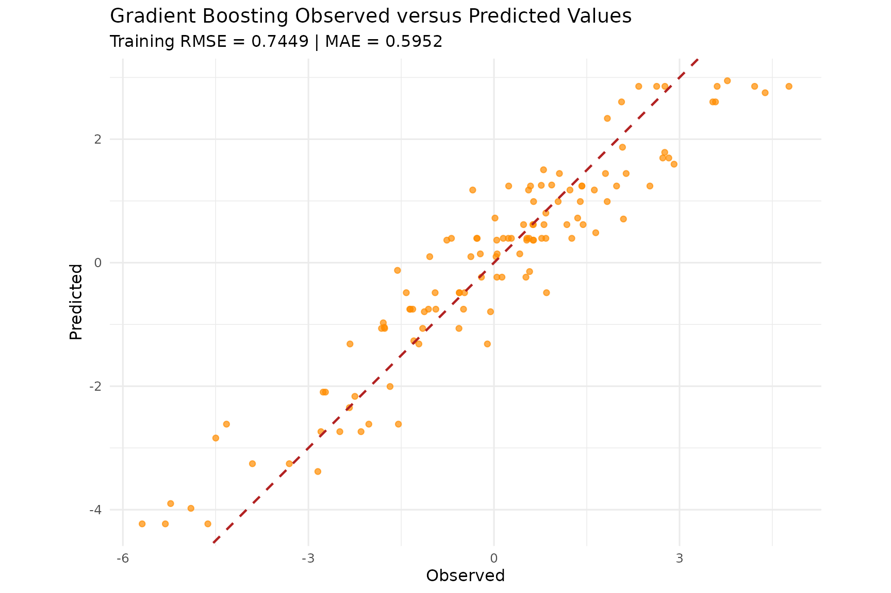

Points close to the dashed diagonal line represent predictions close to
the observed responses.

``` r

ggplot(gbm_diagnostic_data, aes(Predicted, Error)) +
  geom_hline(
    yintercept = 0,
    colour = "firebrick",
    linetype = "dashed",
    linewidth = 0.8
  ) +
  geom_point(alpha = 0.7, colour = "darkorange") +
  geom_smooth(
    method = "loess",
    formula = y ~ x,
    se = FALSE,
    colour = "black",
    linewidth = 0.8
  ) +
  theme_minimal(base_size = 12) +
  labs(
    title = "Gradient Boosting Residual Diagnostic",
    subtitle = "The black curve highlights systematic error patterns",
    x = "Predicted",
    y = "Prediction error (observed - predicted)"
  )
```

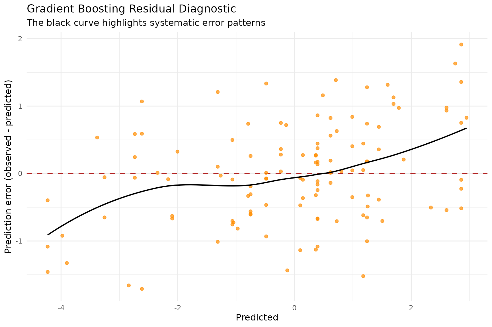

Residuals distributed around zero without a clear pattern indicate
limited systematic error. Curvature in the smoothed line can indicate
structure that remains unexplained.

``` r

ggplot(gbm_diagnostic_data, aes(Error)) +
  geom_histogram(
    bins = 20,
    fill = "darkorange",
    colour = "white",
    alpha = 0.85
  ) +
  geom_vline(
    xintercept = 0,
    colour = "black",
    linetype = "dashed",
    linewidth = 0.9
  ) +
  geom_vline(
    xintercept = gbm_mean_error,
    colour = "firebrick",
    linewidth = 0.9
  ) +
  theme_minimal(base_size = 12) +
  labs(
    title = "Gradient Boosting Prediction-Error Distribution",
    subtitle = paste(
      "Mean error =", round(gbm_mean_error, 4),
      "| Median error =", round(gbm_median_error, 4)
    ),
    x = "Prediction error (observed - predicted)",
    y = "Count"
  )
```

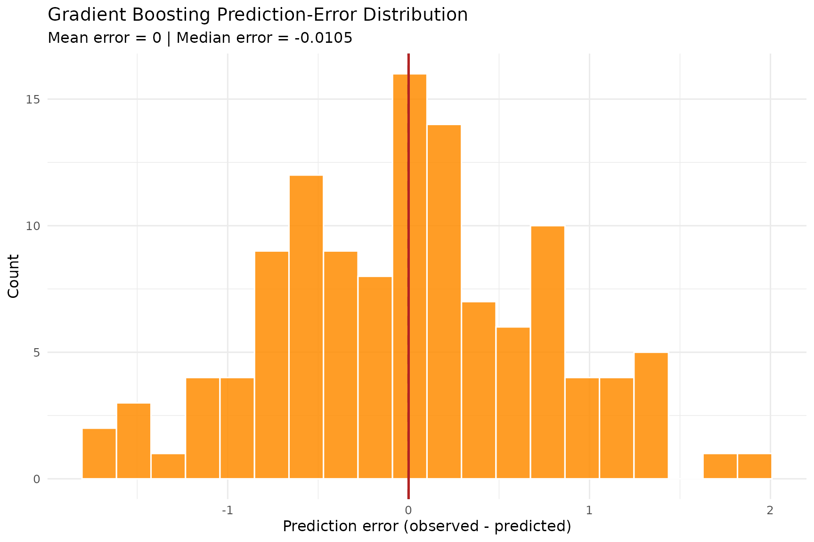

``` r

ggplot(gbm_diagnostic_data, aes(sample = Error)) +
  stat_qq(alpha = 0.7, colour = "darkorange", size = 1.8) +
  stat_qq_line(
    colour = "firebrick",
    linetype = "dashed",
    linewidth = 0.8
  ) +
  theme_minimal(base_size = 12) +
  labs(
    title = "Gradient Boosting Residual Q-Q Plot",
    subtitle = paste("Residual SD =", round(sd(gbm_prediction_error), 4)),
    x = "Theoretical normal quantiles",
    y = "Observed residual quantiles"
  )
```

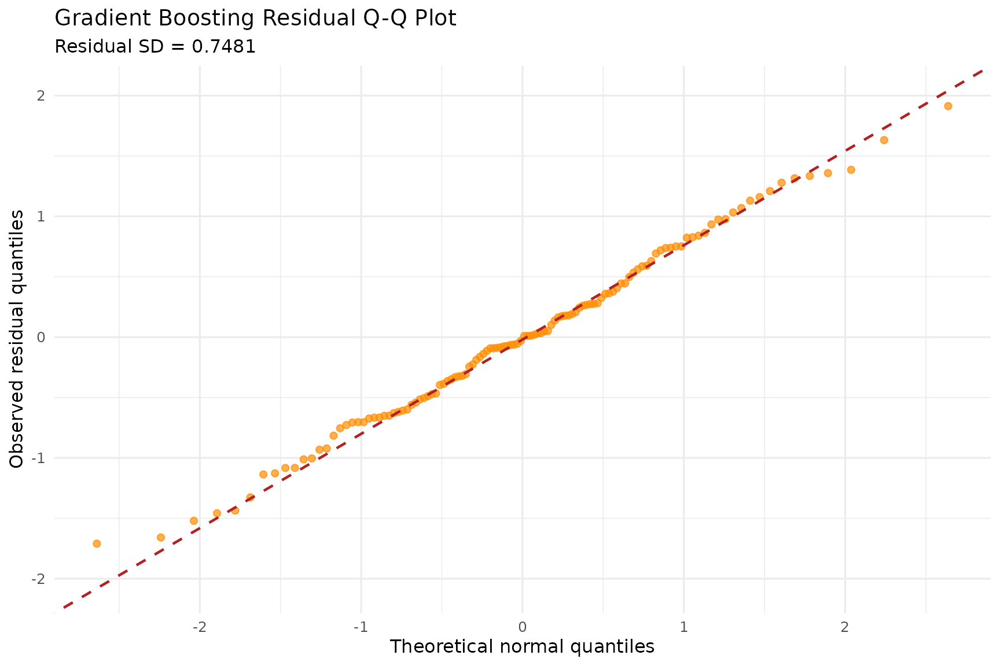

The Q-Q plot is descriptive. Departures from the reference line can
reveal skewness, heavy tails, or isolated large errors.

#### Neural network diagnostics

The following diagnostics examine the neural-network training errors.
Residual normality is not required by the neural-network algorithm; the
Q-Q plot is included only as a descriptive view of the error
distribution.

``` r

nn_diagnostic_data <- data.frame(
  Observed = y_reg,
  Predicted = nn_prediction,
  Error = y_reg - nn_prediction
)

ggplot(nn_diagnostic_data, aes(Observed, Predicted)) +
  geom_point(alpha = 0.7, colour = "dodgerblue3") +
  geom_abline(
    intercept = 0,
    slope = 1,
    colour = "firebrick",
    linetype = "dashed",
    linewidth = 0.8
  ) +
  coord_equal() +
  theme_minimal(base_size = 12) +
  labs(
    title = "Neural Network Observed versus Predicted Values",
    subtitle = paste("Training RMSE =", round(nn_rmse, 4)),
    x = "Observed",
    y = "Predicted"
  )
```

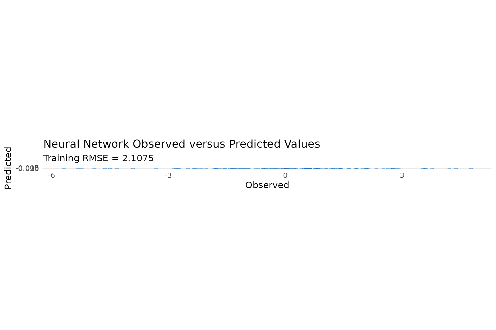

``` r

ggplot(nn_diagnostic_data, aes(Predicted, Error)) +
  geom_hline(
    yintercept = 0,
    colour = "firebrick",
    linetype = "dashed",
    linewidth = 0.8
  ) +
  geom_point(alpha = 0.7, colour = "purple4") +
  theme_minimal(base_size = 12) +
  labs(
    title = "Neural Network Residuals",
    x = "Predicted",
    y = "Prediction error (observed - predicted)"
  )
```


``` r

nn_mean_error <- mean(nn_diagnostic_data$Error)
nn_median_error <- median(nn_diagnostic_data$Error)

ggplot(nn_diagnostic_data, aes(Error)) +
  geom_histogram(
    bins = 20,
    fill = "dodgerblue3",
    colour = "white",
    alpha = 0.85
  ) +
  geom_vline(
    xintercept = 0,
    colour = "black",
    linetype = "dashed",
    linewidth = 0.9
  ) +
  geom_vline(
    xintercept = nn_mean_error,
    colour = "firebrick",
    linewidth = 0.9
  ) +
  theme_minimal(base_size = 12) +
  labs(
    title = "Neural Network Prediction-Error Distribution",
    subtitle = paste(
      "Mean error =", round(nn_mean_error, 4),
      "| Median error =", round(nn_median_error, 4)
    ),
    x = "Prediction error (observed - predicted)",
    y = "Count"
  )
```

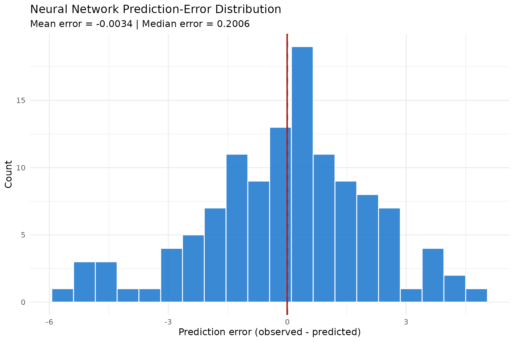

``` r

ggplot(nn_diagnostic_data, aes(sample = Error)) +
  stat_qq(alpha = 0.7, colour = "dodgerblue3", size = 1.8) +
  stat_qq_line(
    colour = "firebrick",
    linetype = "dashed",
    linewidth = 0.8
  ) +
  theme_minimal(base_size = 12) +
  labs(
    title = "Neural Network Residual Q-Q Plot",
    subtitle = paste(
      "Residual mean =", round(mean(nn_diagnostic_data$Error), 4),
      "| Residual SD =", round(sd(nn_diagnostic_data$Error), 4)
    ),
    x = "Theoretical normal quantiles",
    y = "Observed residual quantiles"
  )
```

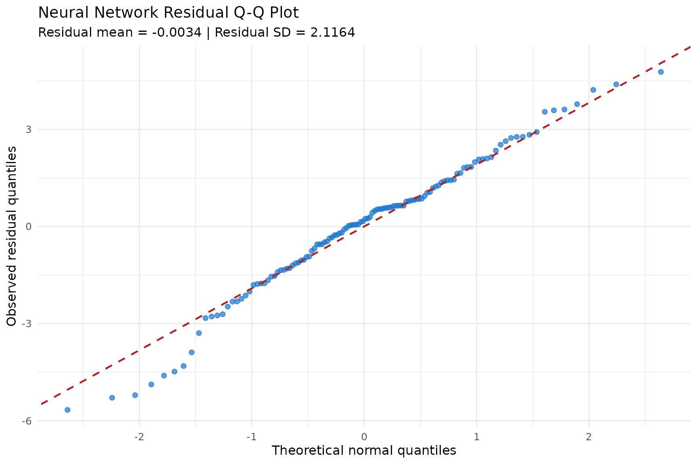

#### Training-set error comparison

This section compares predictions made on the same observations used to
fit each model. These values describe training-set fit and should not be
interpreted as estimates of performance on new observations. A flexible
model can achieve small training error while generalizing poorly. The
later out-of-fold comparison is therefore more informative for
predictive comparison.

``` r

regression_error_comparison <- rbind(
  data.frame(
    Model = "Random forest",
    Observed = y_reg,
    Predicted = rf_reg_prediction
  ),
  data.frame(
    Model = "Gradient boosting",
    Observed = y_reg,
    Predicted = gbm_prediction
  ),
  data.frame(
    Model = "Neural network",
    Observed = y_reg,
    Predicted = nn_prediction
  )
)

regression_error_comparison$Error <- with(
  regression_error_comparison,
  Observed - Predicted
)
regression_error_comparison$AbsoluteError <- abs(regression_error_comparison$Error)
regression_error_comparison$SquaredError <- regression_error_comparison$Error^2
```

``` r

regression_error_summary <- do.call(
  rbind,
  lapply(
    split(regression_error_comparison, regression_error_comparison$Model),
    function(model_data) {
      data.frame(
        Model = model_data$Model[1],
        MeanError = mean(model_data$Error),
        MedianError = median(model_data$Error),
        MAE = mean(model_data$AbsoluteError),
        RMSE = sqrt(mean(model_data$SquaredError)),
        ErrorSD = sd(model_data$Error)
      )
    }
  )
)

regression_error_summary <- regression_error_summary[
  order(regression_error_summary$RMSE),
  ,
  drop = FALSE
]
row.names(regression_error_summary) <- NULL

knitr::kable(
  regression_error_summary,
  digits = 4,
  caption = "Training-set regression error comparison"
)
```

| Model             | MeanError | MedianError |    MAE |   RMSE | ErrorSD |
|:------------------|----------:|------------:|-------:|-------:|--------:|
| Random forest     |   -0.0041 |     -0.0057 | 0.3806 | 0.4591 |  0.4610 |
| Gradient boosting |    0.0000 |     -0.0105 | 0.5952 | 0.7449 |  0.7481 |
| Neural network    |   -0.0034 |      0.2006 | 1.6286 | 2.1075 |  2.1164 |

Training-set regression error comparison {.table}

``` r

model_mean_errors <- aggregate(
  Error ~ Model,
  data = regression_error_comparison,
  FUN = mean
)

ggplot(regression_error_comparison, aes(Error)) +
  geom_histogram(
    bins = 20,
    fill = "steelblue",
    colour = "white",
    alpha = 0.85
  ) +
  geom_vline(
    xintercept = 0,
    colour = "black",
    linetype = "dashed",
    linewidth = 0.8
  ) +
  geom_vline(
    data = model_mean_errors,
    aes(xintercept = Error),
    colour = "firebrick",
    linewidth = 0.8
  ) +
  facet_wrap(~ Model, ncol = 1, scales = "fixed") +
  theme_minimal(base_size = 12) +
  labs(
    title = "Training-Set Prediction-Error Distributions",
    subtitle = "Dashed lines mark zero; red lines mark model-specific means",
    x = "Prediction error",
    y = "Count"
  )
```

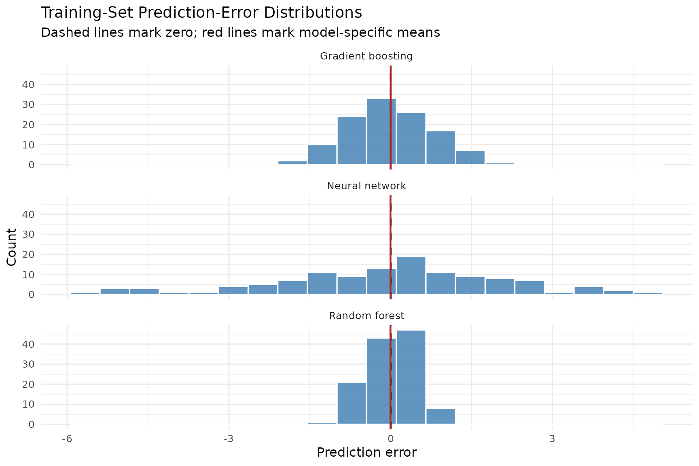

``` r

ggplot(
  regression_error_comparison,
  aes(
    x = reorder(Model, AbsoluteError, FUN = median),
    y = AbsoluteError,
    fill = Model
  )
) +
  geom_boxplot(
    width = 0.65,
    alpha = 0.8,
    outlier.alpha = 0.65,
    show.legend = FALSE
  ) +
  coord_flip() +
  theme_minimal(base_size = 12) +
  labs(
    title = "Absolute Training Error by Regression Model",
    x = NULL,
    y = "Absolute prediction error"
  )
```

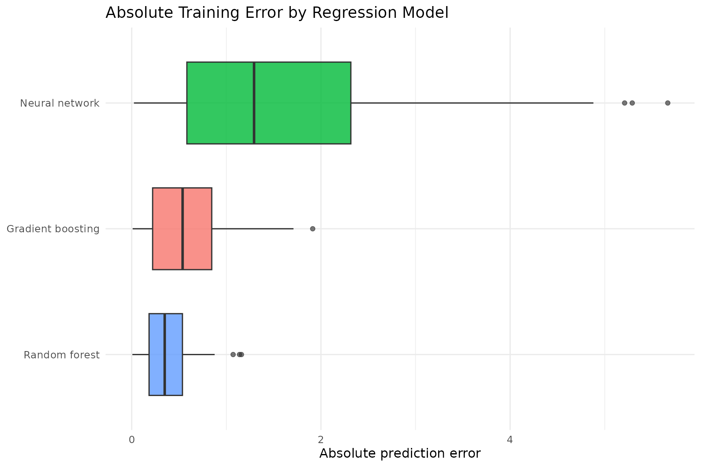

## Model tuning and validation

### Cross-validation setup

A three-fold cross-validation design is used to balance computational
cost with out-of-fold evaluation. Each observation is assigned to one
validation fold. For each iteration, two folds are used for training and
the remaining fold is used for validation.

For neural networks, predictor centers and scales are estimated
separately from each training fold and then applied to the corresponding
validation fold.

``` r

set.seed(452)
n_folds <- 3L
fold_id <- sample(rep(seq_len(n_folds), length.out = nrow(X_reg)))

stopifnot(
  length(fold_id) == nrow(X_reg),
  length(y_reg) == nrow(X_reg)
)

table(fold_id)
#> fold_id
#>  1  2  3 
#> 40 40 40
```

### Learning-rate analysis

The learning rate controls how aggressively each model updates during
training. Values that are too small may produce insufficient learning
for the selected number of iterations. Values that are too large may
cause unstable updates or poor generalization. The following analyses
hold the remaining hyperparameters fixed and vary only the learning
rate.

#### Gradient boosting learning rate

For each candidate learning rate, a 50-tree gradient boosting model is
evaluated using the same three folds. Mean validation RMSE summarizes
predictive error, while the standard deviation shows variability across
folds.

``` r

gbm_learning_rate_values <- c(0.005, 0.01, 0.05, 0.10, 0.20)

gbm_learning_rate_results <- do.call(
  rbind,
  lapply(seq_along(gbm_learning_rate_values), function(rate_index) {
    current_rate <- gbm_learning_rate_values[rate_index]
    fold_rmse <- numeric(n_folds)

    for (fold in seq_len(n_folds)) {
      training_rows <- fold_id != fold
      validation_rows <- fold_id == fold
      set.seed(4000 + rate_index * 100 + fold)

      model <- gradboostr_fit(
        X_reg[training_rows, , drop = FALSE],
        y_reg[training_rows],
        method = "gbm",
        learning_rate = current_rate,
        n_trees = 50
      )

      prediction <- as.vector(
        gradboostr_predict(
          model,
          X_reg[validation_rows, , drop = FALSE],
          type = "response"
        )
      )

      fold_rmse[fold] <- rmse(y_reg[validation_rows], prediction)
    }

    data.frame(
      Model = "Gradient boosting",
      LearningRate = current_rate,
      MeanRMSE = mean(fold_rmse),
      SDRMSE = sd(fold_rmse)
    )
  })
)

gbm_learning_rate_results <- gbm_learning_rate_results[
  order(gbm_learning_rate_results$MeanRMSE),
]
row.names(gbm_learning_rate_results) <- NULL

knitr::kable(
  gbm_learning_rate_results,
  digits = 4,
  caption = "Gradient boosting learning-rate results"
)
```

| Model             | LearningRate | MeanRMSE | SDRMSE |
|:------------------|-------------:|---------:|-------:|
| Gradient boosting |        0.200 |   0.8570 | 0.0867 |
| Gradient boosting |        0.100 |   0.9300 | 0.0723 |
| Gradient boosting |        0.050 |   1.1161 | 0.0983 |
| Gradient boosting |        0.010 |   1.7113 | 0.1444 |
| Gradient boosting |        0.005 |   1.8834 | 0.1295 |

Gradient boosting learning-rate results {.table}

``` r

ggplot(gbm_learning_rate_results, aes(LearningRate, MeanRMSE)) +
  geom_errorbar(
    aes(
      ymin = pmax(MeanRMSE - SDRMSE, 0),
      ymax = MeanRMSE + SDRMSE
    ),
    width = 0.003,
    colour = "grey40"
  ) +
  geom_line(colour = "darkorange", linewidth = 0.8) +
  geom_point(colour = "darkorange", size = 3) +
  scale_x_log10(breaks = sort(gbm_learning_rate_values)) +
  theme_minimal(base_size = 12) +
  labs(
    title = "Gradient Boosting Learning-Rate Analysis",
    x = "Learning rate (log scale)",
    y = "Cross-validated RMSE"
  )
```


#### Neural network learning rate

The neural-network comparison uses 10 hidden units and 50 epochs for
every candidate learning rate. Scaling is recalculated inside each
training fold to prevent preprocessing leakage.

``` r

nn_learning_rate_values <- c(0.001, 0.005, 0.01, 0.05, 0.10)

nn_learning_rate_results <- do.call(
  rbind,
  lapply(seq_along(nn_learning_rate_values), function(rate_index) {
    current_rate <- nn_learning_rate_values[rate_index]
    fold_rmse <- numeric(n_folds)

    for (fold in seq_len(n_folds)) {
      training_rows <- fold_id != fold
      validation_rows <- fold_id == fold

      scaled_fold <- scale_train_validation(
        X_reg[training_rows, , drop = FALSE],
        X_reg[validation_rows, , drop = FALSE]
      )

      set.seed(5000 + rate_index * 100 + fold)

      model <- gradboostr_fit(
        scaled_fold$train,
        y_reg[training_rows],
        method = "nn",
        hidden = 10,
        epochs = 50,
        learning_rate = current_rate
      )

      prediction <- as.vector(
        gradboostr_predict(
          model,
          scaled_fold$validation,
          type = "response"
        )
      )

      fold_rmse[fold] <- rmse(y_reg[validation_rows], prediction)
    }

    data.frame(
      Model = "Neural network",
      LearningRate = current_rate,
      MeanRMSE = mean(fold_rmse),
      SDRMSE = sd(fold_rmse)
    )
  })
)

nn_learning_rate_results <- nn_learning_rate_results[
  order(nn_learning_rate_results$MeanRMSE),
]
row.names(nn_learning_rate_results) <- NULL

knitr::kable(
  nn_learning_rate_results,
  digits = 4,
  caption = "Neural-network learning-rate results"
)
```

| Model          | LearningRate | MeanRMSE | SDRMSE |
|:---------------|-------------:|---------:|-------:|
| Neural network |        0.100 |   0.8219 | 0.0320 |
| Neural network |        0.050 |   0.9353 | 0.0326 |
| Neural network |        0.010 |   2.1078 | 0.1162 |
| Neural network |        0.005 |   2.1082 | 0.1167 |
| Neural network |        0.001 |   2.1085 | 0.1168 |

Neural-network learning-rate results {.table}

``` r

ggplot(nn_learning_rate_results, aes(LearningRate, MeanRMSE)) +
  geom_errorbar(
    aes(
      ymin = pmax(MeanRMSE - SDRMSE, 0),
      ymax = MeanRMSE + SDRMSE
    ),
    width = 0.002,
    colour = "grey40"
  ) +
  geom_line(colour = "dodgerblue3", linewidth = 0.8) +
  geom_point(colour = "dodgerblue3", size = 3) +
  scale_x_log10(breaks = sort(nn_learning_rate_values)) +
  theme_minimal(base_size = 12) +
  labs(
    title = "Neural Network Learning-Rate Analysis",
    x = "Learning rate (log scale)",
    y = "Cross-validated RMSE"
  )
```


### Gradient boosting grid search

The gradient boosting grid varies learning rate and tree count. The
configuration with the smallest mean validation RMSE is retained for the
later out-of-fold comparison.

``` r

gbm_parameter_grid <- expand.grid(
  LearningRate = c(0.01, 0.05, 0.10),
  Trees = c(25, 50),
  KEEP.OUT.ATTRS = FALSE,
  stringsAsFactors = FALSE
)

gbm_cv_results <- do.call(
  rbind,
  lapply(seq_len(nrow(gbm_parameter_grid)), function(parameter_index) {
    parameters <- gbm_parameter_grid[parameter_index, , drop = FALSE]
    fold_rmse <- numeric(n_folds)

    for (fold in seq_len(n_folds)) {
      training_rows <- fold_id != fold
      validation_rows <- fold_id == fold
      set.seed(1000 + parameter_index * 100 + fold)

      model <- gradboostr_fit(
        X_reg[training_rows, , drop = FALSE],
        y_reg[training_rows],
        method = "gbm",
        learning_rate = as.numeric(parameters$LearningRate[[1]]),
        n_trees = as.integer(parameters$Trees[[1]])
      )

      prediction <- as.vector(
        gradboostr_predict(
          model,
          X_reg[validation_rows, , drop = FALSE],
          type = "response"
        )
      )

      fold_rmse[fold] <- rmse(y_reg[validation_rows], prediction)
    }

    data.frame(
      LearningRate = as.numeric(parameters$LearningRate[[1]]),
      Trees = as.integer(parameters$Trees[[1]]),
      MeanRMSE = mean(fold_rmse),
      SDRMSE = sd(fold_rmse)
    )
  })
)

gbm_cv_results <- gbm_cv_results[
  order(gbm_cv_results$MeanRMSE),
  ,
  drop = FALSE
]
row.names(gbm_cv_results) <- NULL
best_gbm_parameters <- gbm_cv_results[1, , drop = FALSE]

knitr::kable(
  gbm_cv_results,
  digits = 4,
  caption = "Gradient boosting grid-search results"
)
```

| LearningRate | Trees | MeanRMSE | SDRMSE |
|-------------:|------:|---------:|-------:|
|         0.10 |    50 |   0.9300 | 0.0723 |
|         0.10 |    25 |   1.1064 | 0.1012 |
|         0.05 |    50 |   1.1161 | 0.0983 |
|         0.05 |    25 |   1.3638 | 0.1336 |
|         0.01 |    50 |   1.7113 | 0.1444 |
|         0.01 |    25 |   1.8829 | 0.1295 |

Gradient boosting grid-search results {.table}

### Neural network grid search

#### Cross-validated compact grid

The compact grid evaluates hidden units, epochs, and learning rate using
three-fold cross-validation. The configuration with the smallest mean
validation RMSE is retained for the later out-of-fold comparison.

``` r

nn_parameter_grid <- expand.grid(
  HiddenUnits = c(5, 10),
  Epochs = c(25, 50),
  LearningRate = c(0.01, 0.05),
  KEEP.OUT.ATTRS = FALSE,
  stringsAsFactors = FALSE
)

nn_cv_results <- do.call(
  rbind,
  lapply(seq_len(nrow(nn_parameter_grid)), function(parameter_index) {
    parameters <- nn_parameter_grid[parameter_index, , drop = FALSE]
    fold_rmse <- numeric(n_folds)

    for (fold in seq_len(n_folds)) {
      training_rows <- fold_id != fold
      validation_rows <- fold_id == fold

      scaled_fold <- scale_train_validation(
        X_reg[training_rows, , drop = FALSE],
        X_reg[validation_rows, , drop = FALSE]
      )

      set.seed(3000 + parameter_index * 100 + fold)

      model <- gradboostr_fit(
        scaled_fold$train,
        y_reg[training_rows],
        method = "nn",
        hidden = as.integer(parameters$HiddenUnits[[1]]),
        epochs = as.integer(parameters$Epochs[[1]]),
        learning_rate = as.numeric(parameters$LearningRate[[1]])
      )

      prediction <- as.vector(
        gradboostr_predict(
          model,
          scaled_fold$validation,
          type = "response"
        )
      )

      fold_rmse[fold] <- rmse(y_reg[validation_rows], prediction)
    }

    data.frame(
      HiddenUnits = as.integer(parameters$HiddenUnits[[1]]),
      Epochs = as.integer(parameters$Epochs[[1]]),
      LearningRate = as.numeric(parameters$LearningRate[[1]]),
      MeanRMSE = mean(fold_rmse),
      SDRMSE = sd(fold_rmse)
    )
  })
)

nn_cv_results <- nn_cv_results[
  order(nn_cv_results$MeanRMSE),
  ,
  drop = FALSE
]
row.names(nn_cv_results) <- NULL
best_nn_parameters <- nn_cv_results[1, , drop = FALSE]

knitr::kable(
  nn_cv_results,
  digits = 4,
  caption = "Neural-network grid-search results"
)
```

| HiddenUnits | Epochs | LearningRate | MeanRMSE | SDRMSE |
|------------:|-------:|-------------:|---------:|-------:|
|          10 |     50 |         0.05 |   0.9423 | 0.1756 |
|           5 |     50 |         0.05 |   1.0021 | 0.1724 |
|          10 |     25 |         0.05 |   2.0191 | 0.1188 |
|           5 |     25 |         0.05 |   2.0773 | 0.1271 |
|          10 |     50 |         0.01 |   2.1062 | 0.1167 |
|           5 |     50 |         0.01 |   2.1077 | 0.1164 |
|          10 |     25 |         0.01 |   2.1084 | 0.1166 |
|           5 |     25 |         0.01 |   2.1086 | 0.1164 |

Neural-network grid-search results {.table}

``` r

nn_heatmap_data <- nn_cv_results
nn_heatmap_data$Epochs <- factor(nn_heatmap_data$Epochs)
rate_levels <- sort(unique(nn_heatmap_data$LearningRate))
nn_heatmap_data$RateLabel <- factor(
  nn_heatmap_data$LearningRate,
  levels = rate_levels,
  labels = paste("Learning rate =", rate_levels)
)

ggplot(nn_heatmap_data, aes(HiddenUnits, Epochs, fill = MeanRMSE)) +
  geom_tile(colour = "white", linewidth = 0.7) +
  geom_text(aes(label = sprintf("%.3f", MeanRMSE)), size = 3.5) +
  facet_wrap(~ RateLabel) +
  scale_fill_viridis_c(option = "C", direction = -1) +
  theme_minimal(base_size = 12) +
  theme(panel.grid = element_blank()) +
  labs(
    title = "Neural Network Cross-Validated Grid Search",
    x = "Hidden units",
    y = "Epochs",
    fill = "CV RMSE"
  )
```


#### Expanded illustrative grid

The expanded grid evaluates 18 combinations using the complete scaled
regression data. Its purpose is to demonstrate how a larger parameter
grid can be constructed and visualized. The reported RMSE values are
training errors and must not replace the preceding cross-validated grid
when selecting hyperparameters for predictive use.

``` r

hidden_grid <- c(5, 10, 20)
epochs_grid <- c(40, 80)
learning_rate_grid <- c(0.10, 0.05, 0.01)

expanded_nn_grid <- expand.grid(
  HiddenUnits = hidden_grid,
  Epochs = epochs_grid,
  LearningRate = learning_rate_grid,
  KEEP.OUT.ATTRS = FALSE,
  stringsAsFactors = FALSE
)
```

``` r

expanded_nn_results <- lapply(seq_len(nrow(expanded_nn_grid)), function(i) {
  hidden_units <- expanded_nn_grid$HiddenUnits[i]
  epochs <- expanded_nn_grid$Epochs[i]
  learning_rate <- expanded_nn_grid$LearningRate[i]
  set.seed(6000 + i)

  model <- gradboostr_fit(
    X_reg_scaled,
    y_reg,
    method = "nn",
    hidden = hidden_units,
    epochs = epochs,
    learning_rate = learning_rate
  )

  prediction <- gradboostr_predict(
    model,
    X_reg_scaled,
    type = "response"
  )

  data.frame(
    HiddenUnits = hidden_units,
    Epochs = epochs,
    LearningRate = learning_rate,
    RMSE = rmse(y_reg, prediction)
  )
})

expanded_nn_results <- do.call(rbind, expanded_nn_results)
expanded_nn_results <- expanded_nn_results[
  order(expanded_nn_results$RMSE),
  ,
  drop = FALSE
]
row.names(expanded_nn_results) <- NULL

knitr::kable(
  expanded_nn_results,
  digits = 4,
  caption = "Expanded neural-network training grid"
)
```

| HiddenUnits | Epochs | LearningRate |   RMSE |
|------------:|-------:|-------------:|-------:|
|          10 |     80 |         0.10 | 0.7233 |
|          20 |     80 |         0.10 | 0.7297 |
|           5 |     80 |         0.10 | 0.7314 |
|          10 |     40 |         0.10 | 0.7315 |
|          20 |     80 |         0.05 | 0.7316 |
|          20 |     40 |         0.10 | 0.7330 |
|           5 |     40 |         0.10 | 0.7399 |
|          10 |     80 |         0.05 | 0.7460 |
|           5 |     80 |         0.05 | 0.7480 |
|          10 |     40 |         0.05 | 0.9476 |
|          20 |     40 |         0.05 | 0.9691 |
|           5 |     40 |         0.05 | 1.9393 |
|          20 |     80 |         0.01 | 2.0887 |
|          10 |     80 |         0.01 | 2.1060 |
|           5 |     80 |         0.01 | 2.1065 |
|          20 |     40 |         0.01 | 2.1085 |
|          10 |     40 |         0.01 | 2.1092 |
|           5 |     40 |         0.01 | 2.1105 |

Expanded neural-network training grid {.table}

``` r

lowest_training_rmse <- expanded_nn_results[1, , drop = FALSE]

knitr::kable(
  lowest_training_rmse,
  digits = 4,
  caption = "Configuration with the lowest expanded-grid training RMSE"
)
```

| HiddenUnits | Epochs | LearningRate |   RMSE |
|------------:|-------:|-------------:|-------:|
|          10 |     80 |          0.1 | 0.7233 |

Configuration with the lowest expanded-grid training RMSE {.table}

``` r

expanded_nn_plot_data <- expanded_nn_results
expanded_nn_plot_data$Epochs <- factor(expanded_nn_plot_data$Epochs)
expanded_rate_levels <- sort(unique(expanded_nn_plot_data$LearningRate))
expanded_nn_plot_data$RateLabel <- factor(
  expanded_nn_plot_data$LearningRate,
  levels = expanded_rate_levels,
  labels = paste("Learning rate =", expanded_rate_levels)
)

ggplot(expanded_nn_plot_data, aes(HiddenUnits, Epochs, fill = RMSE)) +
  geom_tile(colour = "grey70", linewidth = 0.7) +
  geom_text(aes(label = sprintf("%.3f", RMSE)), size = 3.5) +
  facet_wrap(~ RateLabel) +
  scale_x_continuous(breaks = hidden_grid) +
  scale_fill_viridis_c(option = "C", direction = -1) +
  theme_minimal(base_size = 12) +
  theme(panel.grid = element_blank()) +
  labs(
    title = "Expanded Neural Network Grid",
    subtitle = "Training RMSE by hidden units, epochs, and learning rate",
    x = "Hidden units",
    y = "Epochs",
    fill = "RMSE"
  )
```

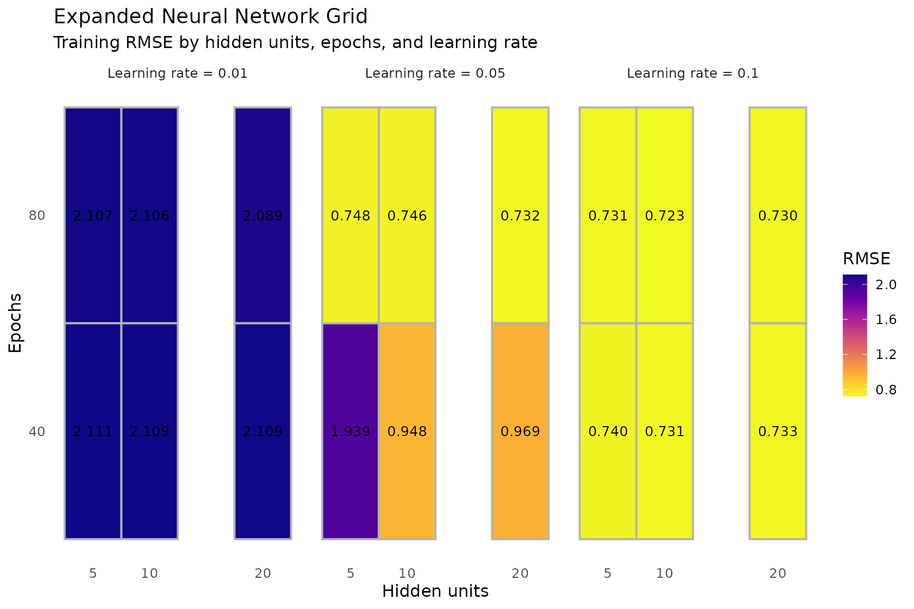

### Selected hyperparameters

``` r

selection_summary <- data.frame(
  Model = c("Gradient boosting", "Neural network"),
  MeanRMSE = c(
    best_gbm_parameters$MeanRMSE,
    best_nn_parameters$MeanRMSE
  ),
  SDRMSE = c(
    best_gbm_parameters$SDRMSE,
    best_nn_parameters$SDRMSE
  )
)

knitr::kable(
  selection_summary,
  digits = 4,
  caption = "Selected cross-validated regression configurations"
)
```

| Model             | MeanRMSE | SDRMSE |
|:------------------|---------:|-------:|
| Gradient boosting |   0.9300 | 0.0723 |
| Neural network    |   0.9423 | 0.1756 |

Selected cross-validated regression configurations {.table}

### Out-of-fold error comparison

The following analysis generates one out-of-fold prediction for each
observation and each regression model. Random forest uses its default
settings. Gradient boosting and neural network use the configurations
selected by the preceding grid searches.

The same three folds are used for both hyperparameter selection and this
comparison. The resulting errors are useful for comparing the fitted
workflows, but they may be optimistic because model selection and
evaluation are not fully independent. Nested cross-validation or a
separate test set would be required for an unbiased post-selection
performance estimate.

``` r

selected_gbm_learning_rate <- as.numeric(
  best_gbm_parameters$LearningRate[[1]]
)
selected_gbm_trees <- as.integer(
  best_gbm_parameters$Trees[[1]]
)
selected_nn_hidden <- as.integer(
  best_nn_parameters$HiddenUnits[[1]]
)
selected_nn_epochs <- as.integer(
  best_nn_parameters$Epochs[[1]]
)
selected_nn_learning_rate <- as.numeric(
  best_nn_parameters$LearningRate[[1]]
)

cv_prediction_results <- vector(
  mode = "list",
  length = n_folds * 3L
)
result_index <- 1L
```

``` r

for (fold in seq_len(n_folds)) {
  training_rows <- fold_id != fold
  validation_rows <- fold_id == fold

  X_training <- X_reg[training_rows, , drop = FALSE]
  y_training <- y_reg[training_rows]
  X_validation <- X_reg[validation_rows, , drop = FALSE]
  y_validation <- y_reg[validation_rows]

  set.seed(7000 + fold)
  cv_rf_model <- gradboostr_fit(
    X_training,
    y_training,
    method = "rf"
  )
  cv_rf_prediction <- as.vector(
    gradboostr_predict(
      cv_rf_model,
      X_validation,
      type = "response"
    )
  )
  cv_prediction_results[[result_index]] <- data.frame(
    Observation = which(validation_rows),
    Fold = fold,
    Model = "Random forest",
    Observed = y_validation,
    Predicted = cv_rf_prediction
  )
  result_index <- result_index + 1L

  set.seed(7100 + fold)
  cv_gbm_model <- gradboostr_fit(
    X_training,
    y_training,
    method = "gbm",
    learning_rate = selected_gbm_learning_rate,
    n_trees = selected_gbm_trees
  )
  cv_gbm_prediction <- as.vector(
    gradboostr_predict(
      cv_gbm_model,
      X_validation,
      type = "response"
    )
  )
  cv_prediction_results[[result_index]] <- data.frame(
    Observation = which(validation_rows),
    Fold = fold,
    Model = "Gradient boosting",
    Observed = y_validation,
    Predicted = cv_gbm_prediction
  )
  result_index <- result_index + 1L

  scaled_fold <- scale_train_validation(X_training, X_validation)
  set.seed(7200 + fold)
  cv_nn_model <- gradboostr_fit(
    scaled_fold$train,
    y_training,
    method = "nn",
    hidden = selected_nn_hidden,
    epochs = selected_nn_epochs,
    learning_rate = selected_nn_learning_rate
  )
  cv_nn_prediction <- as.vector(
    gradboostr_predict(
      cv_nn_model,
      scaled_fold$validation,
      type = "response"
    )
  )
  cv_prediction_results[[result_index]] <- data.frame(
    Observation = which(validation_rows),
    Fold = fold,
    Model = "Neural network",
    Observed = y_validation,
    Predicted = cv_nn_prediction
  )
  result_index <- result_index + 1L
}

cross_validated_predictions <- do.call(rbind, cv_prediction_results)
row.names(cross_validated_predictions) <- NULL
cross_validated_predictions$Error <- with(
  cross_validated_predictions,
  Observed - Predicted
)
cross_validated_predictions$AbsoluteError <- abs(
  cross_validated_predictions$Error
)
cross_validated_predictions$SquaredError <- (
  cross_validated_predictions$Error^2
)

stopifnot(
  nrow(cross_validated_predictions) == 3L * nrow(X_reg),
  all(table(cross_validated_predictions$Model) == nrow(X_reg)),
  all(is.finite(cross_validated_predictions$Error))
)
```

``` r

cross_validated_error_summary <- do.call(
  rbind,
  lapply(
    split(cross_validated_predictions, cross_validated_predictions$Model),
    function(model_data) {
      fold_rmse <- vapply(
        split(model_data, model_data$Fold),
        function(fold_data) sqrt(mean(fold_data$SquaredError)),
        numeric(1)
      )
      fold_mae <- vapply(
        split(model_data, model_data$Fold),
        function(fold_data) mean(fold_data$AbsoluteError),
        numeric(1)
      )

      data.frame(
        Model = model_data$Model[1],
        MeanError = mean(model_data$Error),
        MedianError = median(model_data$Error),
        MAE = mean(model_data$AbsoluteError),
        RMSE = sqrt(mean(model_data$SquaredError)),
        FoldMeanMAE = mean(fold_mae),
        FoldSDMAE = sd(fold_mae),
        FoldMeanRMSE = mean(fold_rmse),
        FoldSDRMSE = sd(fold_rmse)
      )
    }
  )
)

cross_validated_error_summary <- cross_validated_error_summary[
  order(cross_validated_error_summary$RMSE),
  ,
  drop = FALSE
]
row.names(cross_validated_error_summary) <- NULL

knitr::kable(
  cross_validated_error_summary,
  digits = 4,
  caption = paste(n_folds, "fold out-of-fold regression error comparison")
)
```

| Model | MeanError | MedianError | MAE | RMSE | FoldMeanMAE | FoldSDMAE | FoldMeanRMSE | FoldSDRMSE |
|:---|---:|---:|---:|---:|---:|---:|---:|---:|
| Neural network | 0.0118 | 0.0128 | 0.6462 | 0.8464 | 0.6462 | 0.0467 | 0.8454 | 0.0511 |
| Random forest | 0.0145 | -0.0134 | 0.7049 | 0.8834 | 0.7049 | 0.0585 | 0.8818 | 0.0633 |
| Gradient boosting | 0.0062 | 0.0077 | 0.7454 | 0.9319 | 0.7454 | 0.0558 | 0.9300 | 0.0723 |

3 fold out-of-fold regression error comparison {.table}

``` r

cross_validated_metrics_long <- rbind(
  data.frame(
    Model = cross_validated_error_summary$Model,
    Metric = "MAE",
    Value = cross_validated_error_summary$MAE
  ),
  data.frame(
    Model = cross_validated_error_summary$Model,
    Metric = "RMSE",
    Value = cross_validated_error_summary$RMSE
  )
)

ggplot(
  cross_validated_metrics_long,
  aes(x = reorder(Model, Value), y = Value, fill = Metric)
) +
  geom_col(position = "dodge", width = 0.7) +
  coord_flip() +
  theme_minimal(base_size = 12) +
  labs(
    title = "Out-of-Fold Regression Error Comparison",
    subtitle = paste("Metrics calculated from", n_folds, "fold predictions"),
    x = NULL,
    y = "Prediction error",
    fill = "Metric"
  )
```

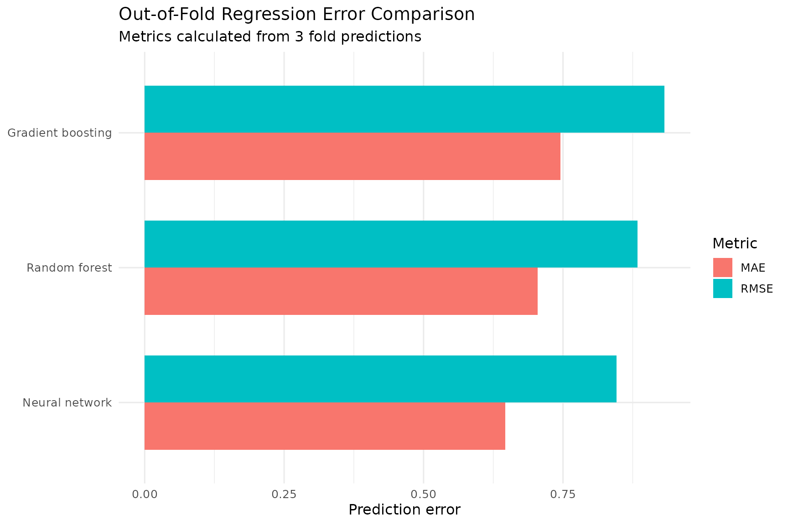

``` r

cv_model_mean_errors <- aggregate(
  Error ~ Model,
  data = cross_validated_predictions,
  FUN = mean
)

ggplot(cross_validated_predictions, aes(Error)) +
  geom_histogram(
    bins = 20,
    fill = "steelblue",
    colour = "white",
    alpha = 0.85
  ) +
  geom_vline(
    xintercept = 0,
    colour = "black",
    linetype = "dashed",
    linewidth = 0.8
  ) +
  geom_vline(
    data = cv_model_mean_errors,
    aes(xintercept = Error),
    colour = "firebrick",
    linewidth = 0.8
  ) +
  facet_wrap(~ Model, ncol = 1, scales = "fixed") +
  theme_minimal(base_size = 12) +
  labs(
    title = "Out-of-Fold Prediction-Error Distributions",
    subtitle = "Dashed lines mark zero; red lines mark model-specific means",
    x = "Out-of-fold prediction error",
    y = "Count"
  )
```

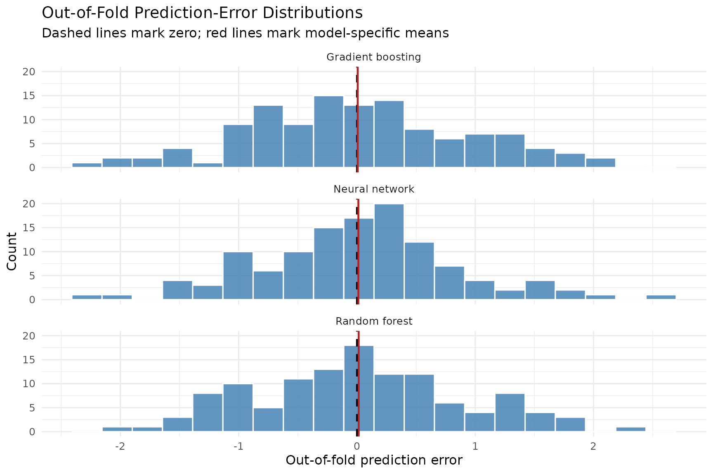

``` r

ggplot(
  cross_validated_predictions,
  aes(
    x = reorder(Model, AbsoluteError, FUN = median),
    y = AbsoluteError,
    fill = Model
  )
) +
  geom_boxplot(
    width = 0.65,
    alpha = 0.8,
    outlier.alpha = 0.65,
    show.legend = FALSE
  ) +
  coord_flip() +
  theme_minimal(base_size = 12) +
  labs(
    title = "Absolute Out-of-Fold Prediction Error",
    x = NULL,
    y = "Absolute out-of-fold error"
  )
```

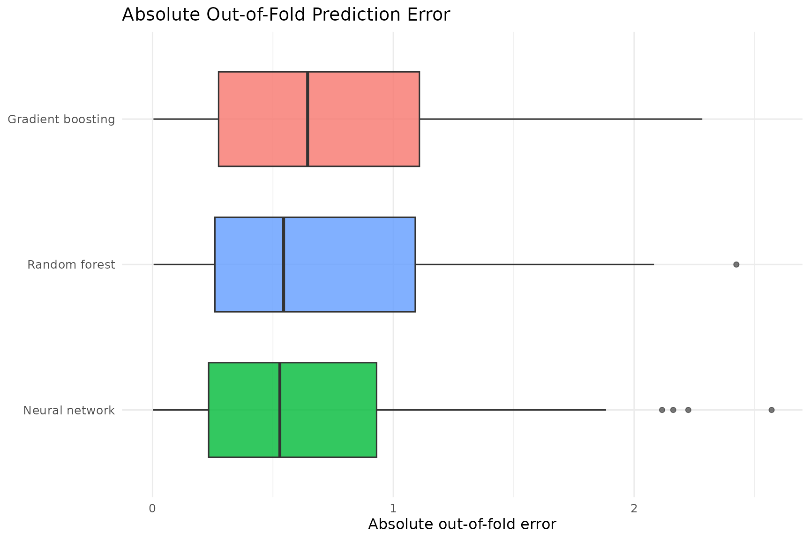

``` r

ggplot(cross_validated_predictions, aes(Observed, Predicted)) +
  geom_point(alpha = 0.65, colour = "steelblue") +
  geom_abline(
    intercept = 0,
    slope = 1,
    colour = "firebrick",
    linetype = "dashed",
    linewidth = 0.8
  ) +
  facet_wrap(~ Model) +
  coord_equal() +
  theme_minimal(base_size = 12) +
  labs(
    title = "Out-of-Fold Predictions by Regression Model",
    subtitle = "The dashed line represents perfect agreement",
    x = "Observed",
    y = "Out-of-fold prediction"
  )
```

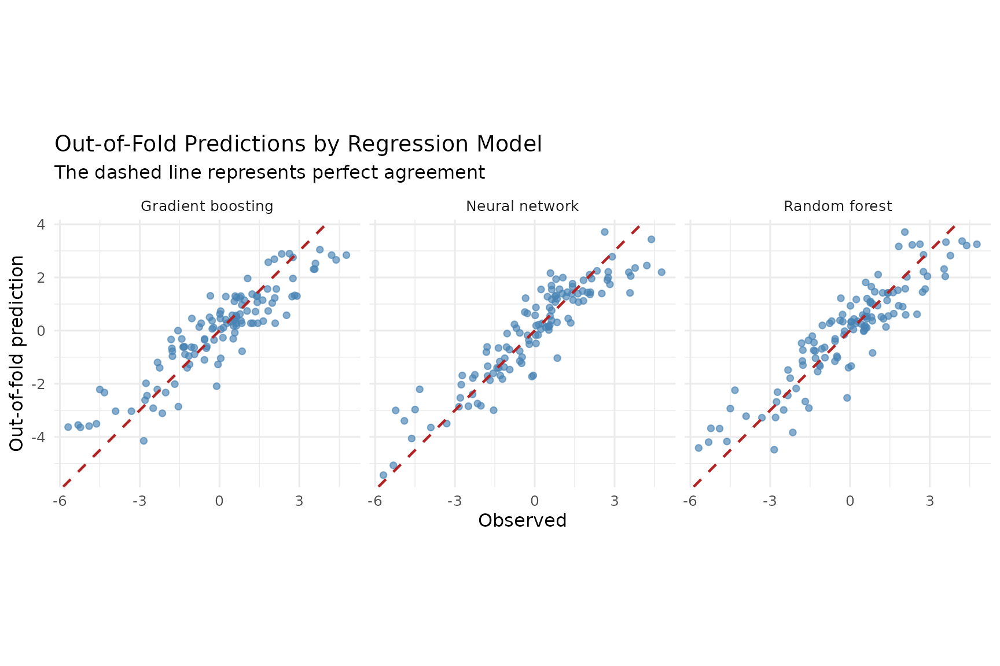

## Decision stump

A decision stump is a one-split regression tree. It selects one
predictor and one threshold, then assigns a constant fitted value to
observations on each side of the split.

The synthetic response below contains a strong discontinuity at
`X1 = 0`, making it suitable for demonstrating a stump. The package
returns the selected feature, threshold, and terminal values. The local
`predict_stump()` helper applies those fitted values to a predictor
matrix.

``` r

set.seed(623)
n_stump <- 200L
X_stump <- cbind(
  X1 = rnorm(n_stump),
  X2 = rnorm(n_stump),
  X3 = rnorm(n_stump)
)
y_stump <- ifelse(
  X_stump[, "X1"] > 0,
  3 + X_stump[, "X2"],
  -3 + X_stump[, "X2"]
) + rnorm(n_stump, sd = 0.4)

stump_model <- fit_stump(X_stump, y_stump)

predict_stump <- function(X, model) {
  feature <- model$feature + 1L
  ifelse(
    X[, feature] <= model$threshold,
    model$left_val,
    model$right_val
  )
}

stump_prediction <- predict_stump(X_stump, stump_model)
stump_rmse <- rmse(y_stump, stump_prediction)

stump_summary <- data.frame(
  FeatureIndex = stump_model$feature + 1L,
  Threshold = stump_model$threshold,
  LeftValue = stump_model$left_val,
  RightValue = stump_model$right_val,
  TrainingRMSE = stump_rmse
)

knitr::kable(
  stump_summary,
  digits = 4,
  caption = "Fitted decision-stump parameters"
)
```

| FeatureIndex | Threshold | LeftValue | RightValue | TrainingRMSE |
|-------------:|----------:|----------:|-----------:|-------------:|
|            2 |    0.0889 |   -2.6944 |     2.8725 |       3.4954 |

Fitted decision-stump parameters {.table}

## Binary classification

The classification examples demonstrate the fast random forest
classification interface on two types of boundaries: an approximately
linear boundary and a nonlinear circular boundary.

Each data set is divided into training and test partitions. The
classifier is fitted using only the training partition, while accuracy
metrics, confusion matrices, ROC curves, and AUC are calculated using
held-out test observations.

### Classification helper functions

`classification_metrics()` calculates threshold-dependent metrics from
hard class predictions. `roc_curve_data()` evaluates sensitivity and
false-positive rate across probability thresholds. `auc_from_roc()`
calculates trapezoidal area under the ROC curve. `confusion_plot_data()`
prepares observed and predicted classes for visualization.

``` r

classification_metrics <- function(actual, predicted) {
  actual <- as.integer(actual)
  predicted <- as.integer(predicted)

  tp <- sum(actual == 1 & predicted == 1)
  tn <- sum(actual == 0 & predicted == 0)
  fp <- sum(actual == 0 & predicted == 1)
  fn <- sum(actual == 1 & predicted == 0)

  precision <- tp / max(1, tp + fp)
  recall <- tp / max(1, tp + fn)

  data.frame(
    Accuracy = (tp + tn) / length(actual),
    Precision = precision,
    Recall = recall,
    Specificity = tn / max(1, tn + fp),
    F1 = if (precision + recall == 0) {
      0
    } else {
      2 * precision * recall / (precision + recall)
    }
  )
}

roc_curve_data <- function(actual, probability) {
  thresholds <- sort(unique(c(Inf, probability, -Inf)), decreasing = TRUE)

  points <- lapply(thresholds, function(threshold) {
    predicted <- as.integer(probability >= threshold)
    tp <- sum(actual == 1 & predicted == 1)
    tn <- sum(actual == 0 & predicted == 0)
    fp <- sum(actual == 0 & predicted == 1)
    fn <- sum(actual == 1 & predicted == 0)

    data.frame(
      Threshold = threshold,
      TPR = tp / max(1, tp + fn),
      FPR = fp / max(1, fp + tn)
    )
  })

  result <- do.call(rbind, points)
  result[order(result$FPR, result$TPR), ]
}

auc_from_roc <- function(roc_data) {
  roc_data <- roc_data[order(roc_data$FPR, roc_data$TPR), ]
  sum(
    diff(roc_data$FPR) *
      (head(roc_data$TPR, -1) + tail(roc_data$TPR, -1)) / 2
  )
}

confusion_plot_data <- function(actual, predicted) {
  as.data.frame(
    table(
      Observed = factor(actual, levels = c(0, 1)),
      Predicted = factor(predicted, levels = c(0, 1))
    )
  )
}
```

### Linear classification example

The response is determined by a noisy linear score based on `X1` and
`X2`. Seventy percent of the observations are used for training and the
remaining observations are retained for testing.

``` r

set.seed(738)
n_linear <- 500L
X_linear <- cbind(
  X1 = rnorm(n_linear),
  X2 = rnorm(n_linear)
)
linear_score <- (
  1.25 * X_linear[, "X1"] -
  0.85 * X_linear[, "X2"] +
  rnorm(n_linear, sd = 0.45)
)
y_linear <- ifelse(linear_score > 0, 1, 0)
linear_train_rows <- sample(seq_len(n_linear), floor(0.70 * n_linear))
linear_test_rows <- setdiff(seq_len(n_linear), linear_train_rows)
```

``` r

linear_forest <- rf_class_fit_fast(
  X_linear[linear_train_rows, , drop = FALSE],
  y_linear[linear_train_rows],
  n_trees = 100,
  max_depth = 6
)
linear_probability <- as.vector(
  GradBoostR::rf_class_predict_prob_fast(
    X_linear[linear_test_rows, , drop = FALSE],
    linear_forest
  )
)
linear_prediction <- as.integer(linear_probability >= 0.5)
linear_metrics <- classification_metrics(
  y_linear[linear_test_rows],
  linear_prediction
)
linear_metrics
#>    Accuracy Precision    Recall Specificity        F1
#> 1 0.9533333 0.9428571 0.9565217   0.9506173 0.9496403
```

``` r

linear_confusion <- confusion_plot_data(
  y_linear[linear_test_rows],
  linear_prediction
)

ggplot(linear_confusion, aes(Predicted, Observed, fill = Freq)) +
  geom_tile(colour = "white", linewidth = 0.8) +
  geom_text(aes(label = Freq), size = 5) +
  scale_fill_viridis_c(option = "C") +
  coord_equal() +
  theme_minimal(base_size = 12) +
  theme(panel.grid = element_blank()) +
  labs(
    title = "Linear Classification Confusion Matrix",
    x = "Predicted class",
    y = "Observed class",
    fill = "Count"
  )
```


``` r

linear_roc <- roc_curve_data(
  y_linear[linear_test_rows],
  linear_probability
)
linear_auc <- auc_from_roc(linear_roc)

ggplot(linear_roc, aes(FPR, TPR)) +
  geom_line(colour = "darkgreen", linewidth = 1) +
  geom_abline(
    intercept = 0,
    slope = 1,
    linetype = "dashed",
    colour = "grey50"
  ) +
  coord_equal() +
  theme_minimal(base_size = 12) +
  labs(
    title = "Linear Classification ROC Curve",
    subtitle = paste("Held-out AUC =", round(linear_auc, 4)),
    x = "False positive rate",
    y = "True positive rate"
  )
```


### Nonlinear classification example

The nonlinear response is determined by distance from the origin.
Observations inside the unit circle belong to class zero, while
observations outside the circle belong to class one. This example
evaluates whether the random forest can learn a curved boundary without
an explicit nonlinear transformation of the predictors.

``` r

set.seed(353)
n_class <- 500L
X_class <- cbind(
  X1 = rnorm(n_class),
  X2 = rnorm(n_class)
)
y_class <- ifelse(
  X_class[, "X1"]^2 + X_class[, "X2"]^2 > 1,
  1,
  0
)
nonlinear_train_rows <- sample(seq_len(n_class), floor(0.70 * n_class))
nonlinear_test_rows <- setdiff(seq_len(n_class), nonlinear_train_rows)
classification_data <- data.frame(
  X1 = X_class[, "X1"],
  X2 = X_class[, "X2"],
  Class = factor(
    y_class,
    levels = c(0, 1),
    labels = c("Inside", "Outside")
  ),
  Partition = ifelse(
    seq_len(n_class) %in% nonlinear_train_rows,
    "Training",
    "Test"
  )
)
```

``` r

ggplot(
  classification_data,
  aes(X1, X2, colour = Class, shape = Partition)
) +
  geom_point(alpha = 0.72) +
  scale_colour_manual(
    values = c("Inside" = "#2166AC", "Outside" = "#B2182B")
  ) +
  coord_equal() +
  theme_minimal(base_size = 12) +
  labs(
    title = "Nonlinear Binary Classification Data",
    subtitle = "The true class boundary is approximately circular"
  )
```


``` r

nonlinear_forest <- rf_class_fit_fast(
  X_class[nonlinear_train_rows, , drop = FALSE],
  y_class[nonlinear_train_rows],
  n_trees = 100,
  max_depth = 6
)
nonlinear_probability <- as.vector(
  GradBoostR::rf_class_predict_prob_fast(
    X_class[nonlinear_test_rows, , drop = FALSE],
    nonlinear_forest
  )
)
nonlinear_prediction <- as.integer(nonlinear_probability >= 0.5)
nonlinear_metrics <- classification_metrics(
  y_class[nonlinear_test_rows],
  nonlinear_prediction
)
nonlinear_metrics
#>    Accuracy Precision    Recall Specificity        F1
#> 1 0.9466667  0.967033 0.9462366   0.9473684 0.9565217
```

``` r

nonlinear_confusion <- confusion_plot_data(
  y_class[nonlinear_test_rows],
  nonlinear_prediction
)

ggplot(nonlinear_confusion, aes(Predicted, Observed, fill = Freq)) +
  geom_tile(colour = "white", linewidth = 0.8) +
  geom_text(aes(label = Freq), size = 5) +
  scale_fill_viridis_c(option = "C") +
  coord_equal() +
  theme_minimal(base_size = 12) +
  theme(panel.grid = element_blank()) +
  labs(
    title = "Nonlinear Classification Confusion Matrix",
    x = "Predicted class",
    y = "Observed class",
    fill = "Count"
  )
```


``` r

nonlinear_roc <- roc_curve_data(
  y_class[nonlinear_test_rows],
  nonlinear_probability
)
nonlinear_auc <- auc_from_roc(nonlinear_roc)

ggplot(nonlinear_roc, aes(FPR, TPR)) +
  geom_line(colour = "dodgerblue3", linewidth = 1) +
  geom_abline(
    intercept = 0,
    slope = 1,
    linetype = "dashed",
    colour = "grey50"
  ) +
  coord_equal() +
  theme_minimal(base_size = 12) +
  labs(
    title = "Nonlinear Classification ROC Curve",
    subtitle = paste("Held-out AUC =", round(nonlinear_auc, 4)),
    x = "False positive rate",
    y = "True positive rate"
  )
```


### Hard-class decision regions

The hard-class plot uses the forest fitted only on the nonlinear
training partition. Every point in the grid is assigned to either the
inside or outside class. The background tiles show predicted classes.
The black contour marks the probability threshold `P(Class = 1) = 0.5`.

``` r

x1_sequence <- seq(
  min(X_class[, "X1"]),
  max(X_class[, "X1"]),
  length.out = 200
)
x2_sequence <- seq(
  min(X_class[, "X2"]),
  max(X_class[, "X2"]),
  length.out = 200
)
decision_boundary_grid <- expand.grid(
  X1 = x1_sequence,
  X2 = x2_sequence
)
decision_boundary_matrix <- as.matrix(
  decision_boundary_grid[, c("X1", "X2")]
)

decision_boundary_grid$PredictedClass <- as.vector(
  GradBoostR::rf_class_predict_fast(
    decision_boundary_matrix,
    nonlinear_forest
  )
)
decision_boundary_grid$Probability <- as.vector(
  GradBoostR::rf_class_predict_prob_fast(
    decision_boundary_matrix,
    nonlinear_forest
  )
)
decision_boundary_grid$PredictedClass <- factor(
  decision_boundary_grid$PredictedClass,
  levels = c(0, 1),
  labels = c("Inside", "Outside")
)

decision_boundary_points <- data.frame(
  X1 = X_class[, "X1"],
  X2 = X_class[, "X2"],
  TrueClass = factor(
    y_class,
    levels = c(0, 1),
    labels = c("Inside", "Outside")
  ),
  Partition = ifelse(
    seq_len(nrow(X_class)) %in% nonlinear_train_rows,
    "Training",
    "Test"
  )
)
```

``` r

ggplot() +
  geom_raster(
    data = decision_boundary_grid,
    aes(X1, X2, fill = PredictedClass),
    alpha = 0.55,
    interpolate = FALSE
  ) +
  geom_contour(
    data = decision_boundary_grid,
    aes(X1, X2, z = Probability),
    breaks = 0.5,
    colour = "black",
    linewidth = 0.9
  ) +
  geom_point(
    data = decision_boundary_points,
    aes(X1, X2, colour = TrueClass, shape = Partition),
    inherit.aes = FALSE,
    alpha = 0.8,
    size = 1.5
  ) +
  scale_fill_manual(
    values = c("Inside" = "#92C5DE", "Outside" = "#F4A582")
  ) +
  scale_colour_manual(
    values = c("Inside" = "#2166AC", "Outside" = "#B2182B")
  ) +
  coord_equal() +
  theme_minimal(base_size = 12) +
  labs(
    title = "Random Forest Decision Regions",
    subtitle = "The black line shows P(Class = 1) = 0.5",
    fill = "Predicted class",
    colour = "True class",
    shape = "Partition"
  )
```

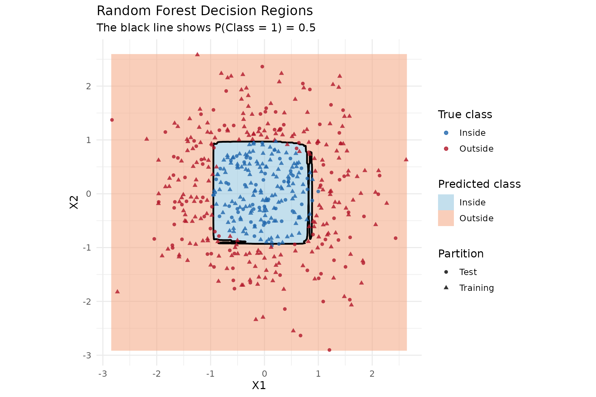

### Probability surface

For visualization only, a second forest is fitted to the complete
nonlinear data set. The resulting surface shows how estimated class-one
probability changes over the two-dimensional predictor space. This
complete-data model is not used to calculate performance metrics.

``` r

classification_surface_forest <- rf_class_fit_fast(
  X_class,
  y_class,
  n_trees = 100,
  max_depth = 6
)
classification_grid <- expand.grid(
  X1 = seq(
    min(classification_data$X1),
    max(classification_data$X1),
    length.out = 150
  ),
  X2 = seq(
    min(classification_data$X2),
    max(classification_data$X2),
    length.out = 150
  )
)
classification_grid$Probability <- as.vector(
  GradBoostR::rf_class_predict_prob_fast(
    as.matrix(classification_grid[, c("X1", "X2")]),
    classification_surface_forest
  )
)
```

``` r

ggplot() +
  geom_raster(
    data = classification_grid,
    aes(X1, X2, fill = Probability),
    interpolate = FALSE
  ) +
  geom_contour(
    data = classification_grid,
    aes(X1, X2, z = Probability),
    breaks = c(0.1, 0.3, 0.5, 0.7, 0.9),
    colour = "white",
    linewidth = 0.45
  ) +
  geom_contour(
    data = classification_grid,
    aes(X1, X2, z = Probability),
    breaks = 0.5,
    colour = "black",
    linewidth = 0.9
  ) +
  geom_point(
    data = classification_data,
    aes(X1, X2, colour = Class),
    alpha = 0.65,
    size = 1.3
  ) +
  scale_fill_viridis_c(limits = c(0, 1), name = "P(Class = 1)") +
  scale_colour_manual(
    values = c("Inside" = "#2166AC", "Outside" = "#B2182B")
  ) +
  coord_equal() +
  theme_minimal(base_size = 12) +
  labs(
    title = "GradBoostR Classification Probability Surface",
    subtitle = "The black contour is the P(Class = 1) = 0.5 boundary"
  )
```


### Classification performance comparison

The final table compares the two held-out classification examples.
Accuracy and F1 use the fixed probability threshold of `0.5`. AUC
summarizes ranking performance across all evaluated thresholds.

``` r

classification_comparison <- rbind(
  data.frame(
    Example = "Linear boundary",
    linear_metrics,
    AUC = linear_auc
  ),
  data.frame(
    Example = "Circular boundary",
    nonlinear_metrics,
    AUC = nonlinear_auc
  )
)

knitr::kable(
  classification_comparison,
  digits = 4,
  caption = "Held-out classification performance"
)
```

| Example           | Accuracy | Precision | Recall | Specificity |     F1 |    AUC |
|:------------------|---------:|----------:|-------:|------------:|-------:|-------:|
| Linear boundary   |   0.9533 |    0.9429 | 0.9565 |      0.9506 | 0.9496 | 0.9743 |
| Circular boundary |   0.9467 |    0.9670 | 0.9462 |      0.9474 | 0.9565 | 0.9823 |

Held-out classification performance {.table style="width:100%;"}

## Summary

This vignette demonstrated the principal `GradBoostR` workflows:

- fitting random forest, gradient boosting, and neural network
  regression models through
  [`gradboostr_fit()`](https://nicjc.github.io/GradBoostR/reference/gradboostr_fit.md);
- generating regression predictions through
  [`gradboostr_predict()`](https://nicjc.github.io/GradBoostR/reference/gradboostr_predict.md);
- validating prediction dimensions and finite outputs;
- examining training-set residuals and prediction-error distributions;
- scaling neural-network predictors without leaking validation
  information;
- comparing learning rates and hyperparameter grids;
- generating out-of-fold predictions for regression-model comparison;
- fitting and interpreting a one-split decision stump;
- fitting binary random forest classifiers;
- evaluating classifiers using held-out confusion matrices, ROC curves,
  and AUC;
- visualizing hard-class decision regions and class-probability
  surfaces.

Training-set diagnostics explain fitted-model behavior, but they do not
estimate performance on new observations. Out-of-fold and held-out
results provide more informative predictive comparisons. Because the
same folds are used for selecting and comparing regression
configurations, nested cross-validation or an independent test set would
be needed for a fully independent post-selection estimate.

The unified regression interface provides a consistent workflow across
model types:

``` r

model <- gradboostr_fit(
  x,
  y,
  method = "gbm"
)

prediction <- gradboostr_predict(
  model,
  newdata,
  type = "response"
)
```

Specialized lower-level functions provide decision-stump fitting and
fast random forest classification.
