# Introduction to GradBoostR

## Overview

`GradBoostR` provides a consistent interface for random forest
regression, gradient boosting regression, neural network regression,
decision stumps, and fast binary random forest classification
implemented with `Rcpp` and `RcppArmadillo`.

The principal interface consists of
[`gradboostr_fit()`](https://nicjc.github.io/GradBoostR/reference/gradboostr_fit.md)
and
[`gradboostr_predict()`](https://nicjc.github.io/GradBoostR/reference/gradboostr_predict.md).
Lower-level functions include
[`fit_stump()`](https://nicjc.github.io/GradBoostR/reference/fit_stump.md),
[`rf_class_fit_fast()`](https://nicjc.github.io/GradBoostR/reference/rf_class_fit_fast.md),
[`rf_class_predict_fast()`](https://nicjc.github.io/GradBoostR/reference/rf_class_predict_fast.md),
and
[`rf_class_predict_prob_fast()`](https://nicjc.github.io/GradBoostR/reference/rf_class_predict_prob_fast.md).

This vignette covers regression, cross-validation, learning-rate
analysis, grid search, final model selection, decision stumps, linear
and nonlinear classification, confusion matrices, ROC curves, AUC, and
probability decision boundaries.

## Regression data

``` r

set.seed(864)

n_reg <- 120
X_reg <- cbind(
  X1 = rnorm(n_reg),
  X2 = rnorm(n_reg),
  X3 = rnorm(n_reg)
)

y_reg <- (
  2.0 * X_reg[, "X1"] -
  0.5 * X_reg[, "X2"] +
  rnorm(n_reg, sd = 0.7)
)

regression_data <- data.frame(
  X1 = X_reg[, "X1"],
  X2 = X_reg[, "X2"],
  X3 = X_reg[, "X3"],
  Response = y_reg
)
head(regression_data, 8)
#>           X1          X2          X3    Response
#> 1  0.8259430 -1.21770927  0.79702852  2.72873606
#> 2  1.6837055 -0.40938819  0.96225350  4.21391230
#> 3 -2.9104891  0.09768491  0.17461701 -5.31318501
#> 4  1.8750856  0.14468638  0.02812713  3.53754995
#> 5  0.6510606  1.66285955 -1.69835956  0.01615669
#> 6 -0.7975370  0.01234072  0.45650717 -1.21428786
#> 7  1.1283158  0.69479572 -0.73021125  2.07743833
#> 8  0.7023991 -1.05993568 -0.29250443  0.59055968
```

``` r

ggplot(regression_data, aes(X1, Response)) +
  geom_point(alpha = 0.7, colour = "steelblue") +
  geom_smooth(
    method = "lm", formula = y ~ x, se = FALSE,
    colour = "firebrick", linewidth = 0.8
  ) +
  theme_minimal(base_size = 12) +
  labs(
    title = "Synthetic Regression Data",
    subtitle = "The response contains a strong contribution from X1",
    x = "X1", y = "Response"
  )
```

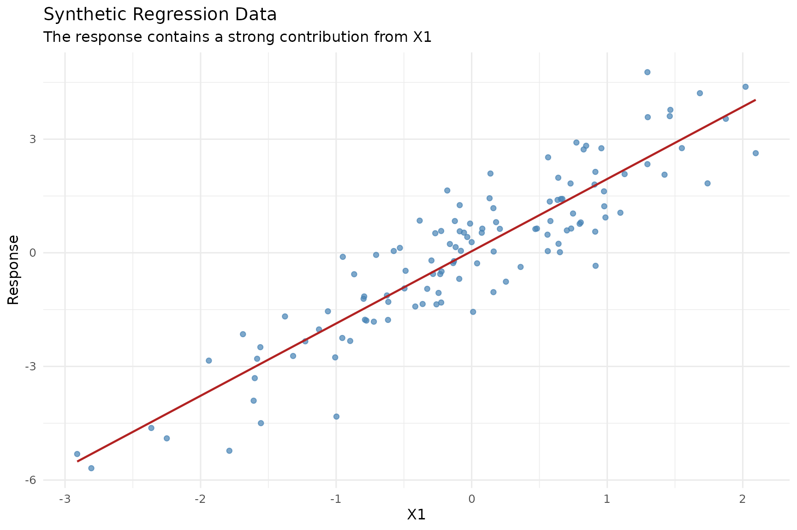

``` r

rmse <- function(actual, predicted) {
  sqrt(mean((actual - predicted)^2))
}

scale_train_validation <- function(training_data, validation_data) {
  training_center <- colMeans(training_data)
  training_scale <- apply(training_data, 2, sd)
  training_scale[!is.finite(training_scale) | training_scale == 0] <- 1

  scaled_training <- sweep(training_data, 2, training_center, FUN = "-")
  scaled_training <- sweep(scaled_training, 2, training_scale, FUN = "/")

  scaled_validation <- sweep(validation_data, 2, training_center, FUN = "-")
  scaled_validation <- sweep(scaled_validation, 2, training_scale, FUN = "/")

  list(train = scaled_training, validation = scaled_validation)
}
```

## Baseline regression models

### Random forest regression

``` r

rf_reg_model <- gradboostr_fit(X_reg, y_reg, method = "rf")
rf_reg_prediction <- as.vector(
  gradboostr_predict(rf_reg_model, X_reg)
)
rf_reg_rmse <- rmse(y_reg, rf_reg_prediction)
rf_reg_rmse
#> [1] 0.4590821
```

### Gradient boosting regression

``` r

gbm_model <- gradboostr_fit(
  X_reg, y_reg,
  method = "gbm",
  learning_rate = 0.1,
  n_trees = 50
)
gbm_prediction <- as.vector(
  gradboostr_predict(gbm_model, X_reg)
)
gbm_rmse <- rmse(y_reg, gbm_prediction)
gbm_rmse
#> [1] 0.744947
```

### Neural network regression

``` r

X_reg_scaled <- scale(X_reg)
set.seed(273)

nn_model <- gradboostr_fit(
  X_reg_scaled, y_reg,
  method = "nn",
  hidden = 10,
  epochs = 50,
  learning_rate = 0.01
)
nn_prediction <- as.vector(
  gradboostr_predict(nn_model, X_reg_scaled)
)
nn_rmse <- rmse(y_reg, nn_prediction)
nn_rmse
#> [1] 2.107537
```

### Baseline model comparison

``` r

baseline_results <- data.frame(
  Model = c("Random forest", "Gradient boosting", "Neural network"),
  RMSE = c(rf_reg_rmse, gbm_rmse, nn_rmse)
)

knitr::kable(
  baseline_results,
  digits = 4,
  caption = "In-sample regression RMSE"
)
```

| Model             |   RMSE |
|:------------------|-------:|
| Random forest     | 0.4591 |
| Gradient boosting | 0.7449 |
| Neural network    | 2.1075 |

In-sample regression RMSE {.table}

``` r

ggplot(
  baseline_results,
  aes(reorder(Model, RMSE), RMSE, fill = Model)
) +
  geom_col(show.legend = FALSE, width = 0.7) +
  coord_flip() +
  theme_minimal(base_size = 12) +
  labs(
    title = "Baseline Regression Model Comparison",
    subtitle = "Lower RMSE indicates better in-sample fit",
    x = NULL, y = "RMSE"
  )
```

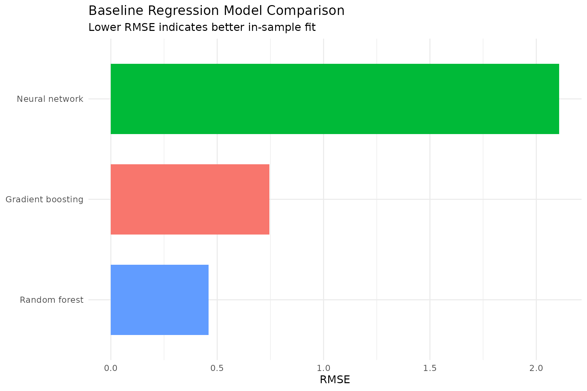

``` r

baseline_predictions <- rbind(
  data.frame(Observed = y_reg, Predicted = rf_reg_prediction, Model = "Random forest"),
  data.frame(Observed = y_reg, Predicted = gbm_prediction, Model = "Gradient boosting"),
  data.frame(Observed = y_reg, Predicted = nn_prediction, Model = "Neural network")
)

ggplot(baseline_predictions, aes(Observed, Predicted)) +
  geom_point(alpha = 0.6, colour = "steelblue") +
  geom_abline(
    intercept = 0, slope = 1,
    colour = "firebrick", linetype = "dashed"
  ) +
  facet_wrap(~ Model) +
  coord_equal() +
  theme_minimal(base_size = 12) +
  labs(
    title = "Regression Predictions by Model",
    subtitle = "The dashed line represents perfect agreement",
    x = "Observed", y = "Predicted"
  )
```

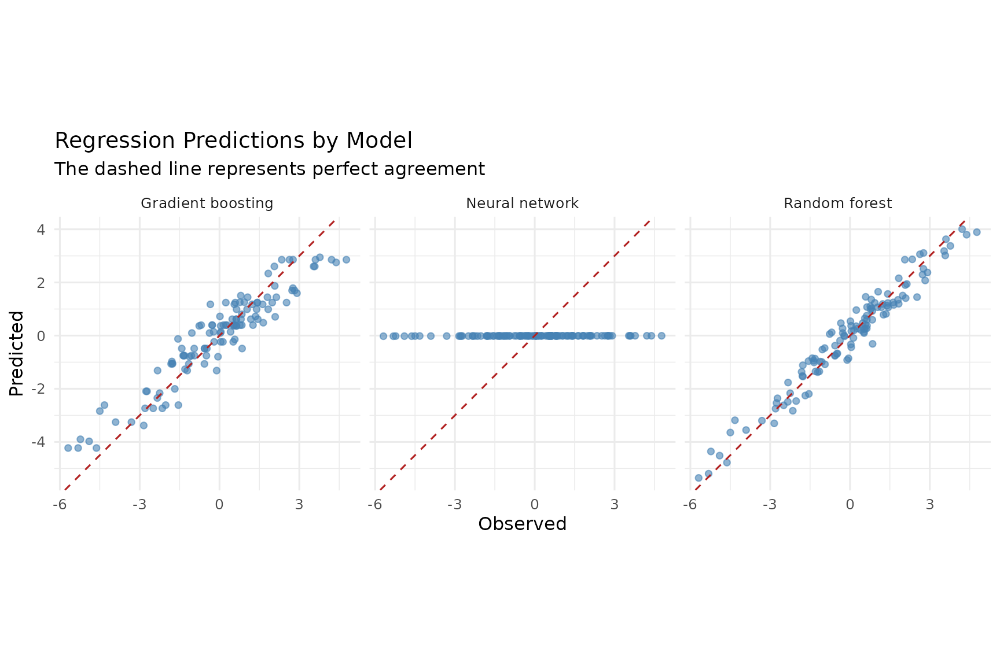

``` r

nn_residual_data <- data.frame(
  Predicted = nn_prediction,
  Residual = y_reg - nn_prediction
)

ggplot(nn_residual_data, aes(Predicted, Residual)) +
  geom_hline(yintercept = 0, colour = "firebrick", linetype = "dashed") +
  geom_point(alpha = 0.7, colour = "purple4") +
  theme_minimal(base_size = 12) +
  labs(
    title = "Neural Network Residuals",
    x = "Predicted", y = "Residual"
  )
```

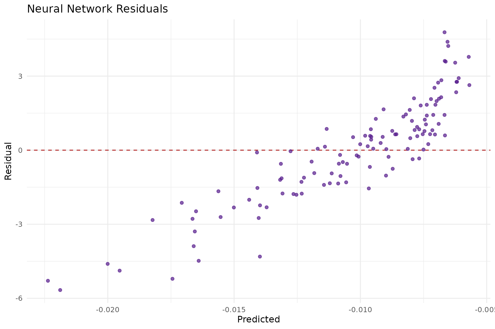

## Cross-validation setup

A compact three-fold design is used to keep vignette build time
manageable.

``` r

set.seed(452)

n_folds <- 3
fold_id <- sample(
  rep(seq_len(n_folds), length.out = nrow(X_reg))
)

stopifnot(
  length(fold_id) == nrow(X_reg),
  length(y_reg) == nrow(X_reg)
)
table(fold_id)
#> fold_id
#>  1  2  3 
#> 40 40 40
```

## Learning-rate analysis

### Gradient boosting learning rate

``` r

gbm_learning_rate_values <- c(0.005, 0.01, 0.05, 0.10, 0.20)

gbm_learning_rate_results <- do.call(
  rbind,
  lapply(seq_along(gbm_learning_rate_values), function(rate_index) {
    current_rate <- gbm_learning_rate_values[rate_index]
    fold_rmse <- numeric(n_folds)

    for (fold in seq_len(n_folds)) {
      training_rows <- fold_id != fold
      validation_rows <- fold_id == fold
      set.seed(4000 + rate_index * 100 + fold)

      model <- gradboostr_fit(
        X_reg[training_rows, , drop = FALSE],
        y_reg[training_rows],
        method = "gbm",
        learning_rate = current_rate,
        n_trees = 50
      )

      prediction <- as.vector(
        gradboostr_predict(
          model,
          X_reg[validation_rows, , drop = FALSE]
        )
      )

      fold_rmse[fold] <- rmse(y_reg[validation_rows], prediction)
    }

    data.frame(
      Model = "Gradient boosting",
      LearningRate = current_rate,
      MeanRMSE = mean(fold_rmse),
      SDRMSE = sd(fold_rmse)
    )
  })
)

gbm_learning_rate_results <- gbm_learning_rate_results[
  order(gbm_learning_rate_results$MeanRMSE),
]
row.names(gbm_learning_rate_results) <- NULL

knitr::kable(
  gbm_learning_rate_results,
  digits = 4,
  caption = paste(n_folds, "fold gradient boosting learning-rate results")
)
```

| Model             | LearningRate | MeanRMSE | SDRMSE |
|:------------------|-------------:|---------:|-------:|
| Gradient boosting |        0.200 |   0.8570 | 0.0867 |
| Gradient boosting |        0.100 |   0.9300 | 0.0723 |
| Gradient boosting |        0.050 |   1.1161 | 0.0983 |
| Gradient boosting |        0.010 |   1.7113 | 0.1444 |
| Gradient boosting |        0.005 |   1.8834 | 0.1295 |

3 fold gradient boosting learning-rate results {.table}

``` r

ggplot(gbm_learning_rate_results, aes(LearningRate, MeanRMSE)) +
  geom_errorbar(
    aes(
      ymin = pmax(MeanRMSE - SDRMSE, 0),
      ymax = MeanRMSE + SDRMSE
    ),
    width = 0.003,
    colour = "grey40"
  ) +
  geom_line(colour = "darkorange", linewidth = 0.8) +
  geom_point(colour = "darkorange", size = 3) +
  scale_x_log10(breaks = sort(gbm_learning_rate_values)) +
  theme_minimal(base_size = 12) +
  labs(
    title = "Gradient Boosting Learning-Rate Analysis",
    subtitle = paste("Mean validation RMSE across", n_folds, "folds"),
    x = "Learning rate (log scale)",
    y = "Cross-validated RMSE"
  )
```

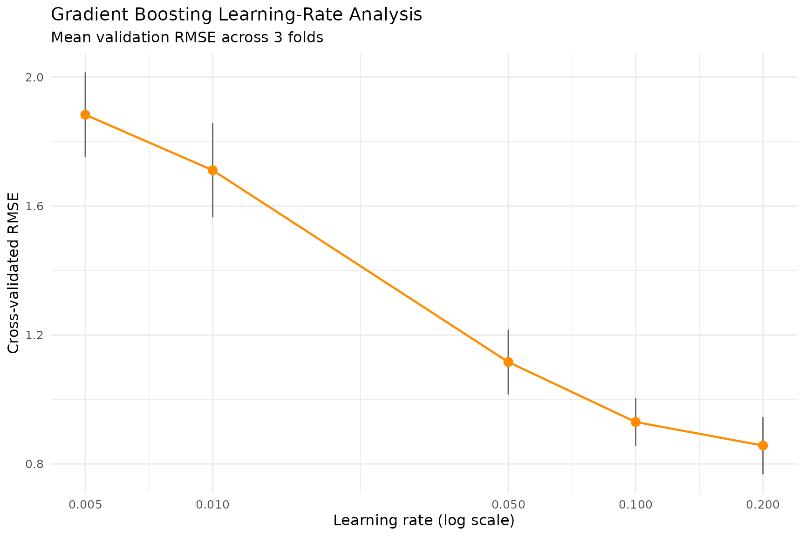

### Neural network learning rate

``` r

nn_learning_rate_values <- c(0.001, 0.005, 0.01, 0.05, 0.10)

nn_learning_rate_results <- do.call(
  rbind,
  lapply(seq_along(nn_learning_rate_values), function(rate_index) {
    current_rate <- nn_learning_rate_values[rate_index]
    fold_rmse <- numeric(n_folds)

    for (fold in seq_len(n_folds)) {
      training_rows <- fold_id != fold
      validation_rows <- fold_id == fold

      scaled_fold <- scale_train_validation(
        X_reg[training_rows, , drop = FALSE],
        X_reg[validation_rows, , drop = FALSE]
      )

      set.seed(5000 + rate_index * 100 + fold)

      model <- gradboostr_fit(
        scaled_fold$train,
        y_reg[training_rows],
        method = "nn",
        hidden = 10,
        epochs = 50,
        learning_rate = current_rate
      )

      prediction <- as.vector(
        gradboostr_predict(model, scaled_fold$validation)
      )
      fold_rmse[fold] <- rmse(y_reg[validation_rows], prediction)
    }

    data.frame(
      Model = "Neural network",
      LearningRate = current_rate,
      MeanRMSE = mean(fold_rmse),
      SDRMSE = sd(fold_rmse)
    )
  })
)

nn_learning_rate_results <- nn_learning_rate_results[
  order(nn_learning_rate_results$MeanRMSE),
]
row.names(nn_learning_rate_results) <- NULL

knitr::kable(
  nn_learning_rate_results,
  digits = 4,
  caption = paste(n_folds, "fold neural-network learning-rate results")
)
```

| Model          | LearningRate | MeanRMSE | SDRMSE |
|:---------------|-------------:|---------:|-------:|
| Neural network |        0.100 |   0.8219 | 0.0320 |
| Neural network |        0.050 |   0.9353 | 0.0326 |
| Neural network |        0.010 |   2.1078 | 0.1162 |
| Neural network |        0.005 |   2.1082 | 0.1167 |
| Neural network |        0.001 |   2.1085 | 0.1168 |

3 fold neural-network learning-rate results {.table}

``` r

ggplot(nn_learning_rate_results, aes(LearningRate, MeanRMSE)) +
  geom_errorbar(
    aes(
      ymin = pmax(MeanRMSE - SDRMSE, 0),
      ymax = MeanRMSE + SDRMSE
    ),
    width = 0.002,
    colour = "grey40"
  ) +
  geom_line(colour = "dodgerblue3", linewidth = 0.8) +
  geom_point(colour = "dodgerblue3", size = 3) +
  scale_x_log10(breaks = sort(nn_learning_rate_values)) +
  theme_minimal(base_size = 12) +
  labs(
    title = "Neural Network Learning-Rate Analysis",
    subtitle = paste("Mean validation RMSE across", n_folds, "folds"),
    x = "Learning rate (log scale)",
    y = "Cross-validated RMSE"
  )
```

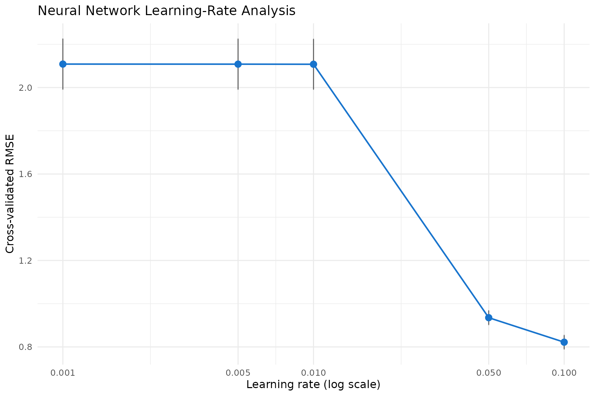

### Combined learning-rate comparison

``` r

combined_learning_rate_results <- rbind(
  gbm_learning_rate_results,
  nn_learning_rate_results
)

ggplot(
  combined_learning_rate_results,
  aes(LearningRate, MeanRMSE, colour = Model, group = Model)
) +
  geom_errorbar(
    aes(
      ymin = pmax(MeanRMSE - SDRMSE, 0),
      ymax = MeanRMSE + SDRMSE
    ),
    width = 0.002,
    alpha = 0.65
  ) +
  geom_line(linewidth = 0.8) +
  geom_point(size = 3) +
  scale_x_log10(
    breaks = sort(unique(combined_learning_rate_results$LearningRate))
  ) +
  scale_colour_manual(
    values = c(
      "Gradient boosting" = "darkorange",
      "Neural network" = "dodgerblue3"
    )
  ) +
  theme_minimal(base_size = 12) +
  labs(
    title = "Cross-Validated Learning-Rate Comparison",
    subtitle = paste("Mean validation RMSE across", n_folds, "folds"),
    x = "Learning rate (log scale)",
    y = "Cross-validated RMSE",
    colour = "Model"
  )
```

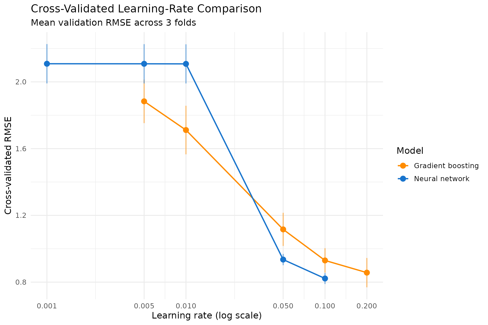

## Gradient boosting grid search

``` r

gbm_parameter_grid <- expand.grid(
  LearningRate = c(0.01, 0.05, 0.10),
  Trees = c(25, 50),
  KEEP.OUT.ATTRS = FALSE,
  stringsAsFactors = FALSE
)

gbm_cv_results <- do.call(
  rbind,
  lapply(seq_len(nrow(gbm_parameter_grid)), function(parameter_index) {
    parameters <- gbm_parameter_grid[parameter_index, , drop = FALSE]
    fold_rmse <- numeric(n_folds)

    for (fold in seq_len(n_folds)) {
      training_rows <- fold_id != fold
      validation_rows <- fold_id == fold
      set.seed(1000 + parameter_index * 100 + fold)

      model <- gradboostr_fit(
        X_reg[training_rows, , drop = FALSE],
        y_reg[training_rows],
        method = "gbm",
        learning_rate = parameters$LearningRate,
        n_trees = parameters$Trees
      )

      prediction <- as.vector(
        gradboostr_predict(
          model,
          X_reg[validation_rows, , drop = FALSE]
        )
      )
      fold_rmse[fold] <- rmse(y_reg[validation_rows], prediction)
    }

    data.frame(
      LearningRate = parameters$LearningRate,
      Trees = parameters$Trees,
      MeanRMSE = mean(fold_rmse),
      SDRMSE = sd(fold_rmse)
    )
  })
)

gbm_cv_results <- gbm_cv_results[order(gbm_cv_results$MeanRMSE), ]
row.names(gbm_cv_results) <- NULL
best_gbm_parameters <- gbm_cv_results[1, , drop = FALSE]

knitr::kable(
  gbm_cv_results,
  digits = 4,
  caption = "Gradient boosting grid-search results"
)
```

| LearningRate | Trees | MeanRMSE | SDRMSE |
|-------------:|------:|---------:|-------:|
|         0.10 |    50 |   0.9300 | 0.0723 |
|         0.10 |    25 |   1.1064 | 0.1012 |
|         0.05 |    50 |   1.1161 | 0.0983 |
|         0.05 |    25 |   1.3638 | 0.1336 |
|         0.01 |    50 |   1.7113 | 0.1444 |
|         0.01 |    25 |   1.8829 | 0.1295 |

Gradient boosting grid-search results {.table}

``` r

gbm_grid_plot <- gbm_cv_results
gbm_grid_plot$Trees <- factor(gbm_grid_plot$Trees)

ggplot(
  gbm_grid_plot,
  aes(LearningRate, MeanRMSE, colour = Trees, group = Trees)
) +
  geom_errorbar(
    aes(
      ymin = pmax(MeanRMSE - SDRMSE, 0),
      ymax = MeanRMSE + SDRMSE
    ),
    width = 0.004
  ) +
  geom_line(linewidth = 0.8) +
  geom_point(size = 3) +
  theme_minimal(base_size = 12) +
  labs(
    title = "Gradient Boosting Grid Search",
    x = "Learning rate",
    y = "Cross-validated RMSE",
    colour = "Trees"
  )
```

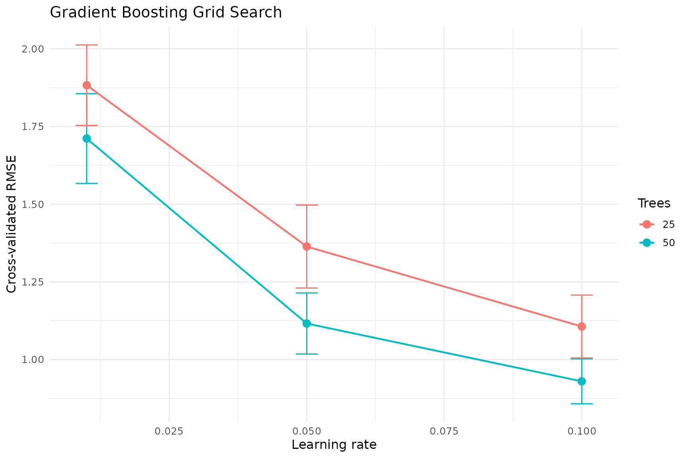

## Neural network grid search

``` r

nn_parameter_grid <- expand.grid(
  HiddenUnits = c(5, 10),
  Epochs = c(25, 50),
  LearningRate = c(0.01, 0.05),
  KEEP.OUT.ATTRS = FALSE,
  stringsAsFactors = FALSE
)

nn_cv_results <- do.call(
  rbind,
  lapply(seq_len(nrow(nn_parameter_grid)), function(parameter_index) {
    parameters <- nn_parameter_grid[parameter_index, , drop = FALSE]
    fold_rmse <- numeric(n_folds)

    for (fold in seq_len(n_folds)) {
      training_rows <- fold_id != fold
      validation_rows <- fold_id == fold

      scaled_fold <- scale_train_validation(
        X_reg[training_rows, , drop = FALSE],
        X_reg[validation_rows, , drop = FALSE]
      )
      set.seed(3000 + parameter_index * 100 + fold)

      model <- gradboostr_fit(
        scaled_fold$train,
        y_reg[training_rows],
        method = "nn",
        hidden = parameters$HiddenUnits,
        epochs = parameters$Epochs,
        learning_rate = parameters$LearningRate
      )

      prediction <- as.vector(
        gradboostr_predict(model, scaled_fold$validation)
      )
      fold_rmse[fold] <- rmse(y_reg[validation_rows], prediction)
    }

    data.frame(
      HiddenUnits = parameters$HiddenUnits,
      Epochs = parameters$Epochs,
      LearningRate = parameters$LearningRate,
      MeanRMSE = mean(fold_rmse),
      SDRMSE = sd(fold_rmse)
    )
  })
)

nn_cv_results <- nn_cv_results[order(nn_cv_results$MeanRMSE), ]
row.names(nn_cv_results) <- NULL
best_nn_parameters <- nn_cv_results[1, , drop = FALSE]

knitr::kable(
  nn_cv_results,
  digits = 4,
  caption = "Neural-network grid-search results"
)
```

| HiddenUnits | Epochs | LearningRate | MeanRMSE | SDRMSE |
|------------:|-------:|-------------:|---------:|-------:|
|          10 |     50 |         0.05 |   0.9423 | 0.1756 |
|           5 |     50 |         0.05 |   1.0021 | 0.1724 |
|          10 |     25 |         0.05 |   2.0191 | 0.1188 |
|           5 |     25 |         0.05 |   2.0773 | 0.1271 |
|          10 |     50 |         0.01 |   2.1062 | 0.1167 |
|           5 |     50 |         0.01 |   2.1077 | 0.1164 |
|          10 |     25 |         0.01 |   2.1084 | 0.1166 |
|           5 |     25 |         0.01 |   2.1086 | 0.1164 |

Neural-network grid-search results {.table}

``` r

nn_heatmap_data <- nn_cv_results
nn_heatmap_data$Epochs <- factor(nn_heatmap_data$Epochs)
rate_levels <- sort(unique(nn_heatmap_data$LearningRate))
nn_heatmap_data$RateLabel <- factor(
  nn_heatmap_data$LearningRate,
  levels = rate_levels,
  labels = paste("Learning rate =", rate_levels)
)

ggplot(nn_heatmap_data, aes(HiddenUnits, Epochs, fill = MeanRMSE)) +
  geom_tile(colour = "white", linewidth = 0.7) +
  geom_text(aes(label = sprintf("%.3f", MeanRMSE)), size = 3.5) +
  facet_wrap(~ RateLabel) +
  scale_fill_viridis_c(option = "C", direction = -1) +
  theme_minimal(base_size = 12) +
  theme(panel.grid = element_blank()) +
  labs(
    title = "Neural Network Grid Search",
    x = "Hidden units",
    y = "Epochs",
    fill = "CV RMSE"
  )
```

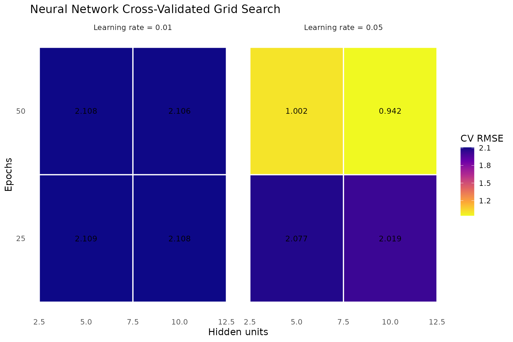

## Cross-validated model selection

``` r

selection_summary <- data.frame(
  Model = c("Gradient boosting", "Neural network"),
  MeanRMSE = c(
    best_gbm_parameters$MeanRMSE,
    best_nn_parameters$MeanRMSE
  ),
  SDRMSE = c(
    best_gbm_parameters$SDRMSE,
    best_nn_parameters$SDRMSE
  )
)

knitr::kable(
  selection_summary,
  digits = 4,
  caption = "Selected cross-validated regression models"
)
```

| Model             | MeanRMSE | SDRMSE |
|:------------------|---------:|-------:|
| Gradient boosting |   0.9300 | 0.0723 |
| Neural network    |   0.9423 | 0.1756 |

Selected cross-validated regression models {.table}

``` r

ggplot(
  selection_summary,
  aes(reorder(Model, MeanRMSE), MeanRMSE, fill = Model)
) +
  geom_col(show.legend = FALSE, width = 0.65) +
  geom_errorbar(
    aes(
      ymin = pmax(MeanRMSE - SDRMSE, 0),
      ymax = MeanRMSE + SDRMSE
    ),
    width = 0.15
  ) +
  coord_flip() +
  theme_minimal(base_size = 12) +
  labs(
    title = "Cross-Validated Model Selection",
    x = NULL,
    y = "Cross-validated RMSE"
  )
```

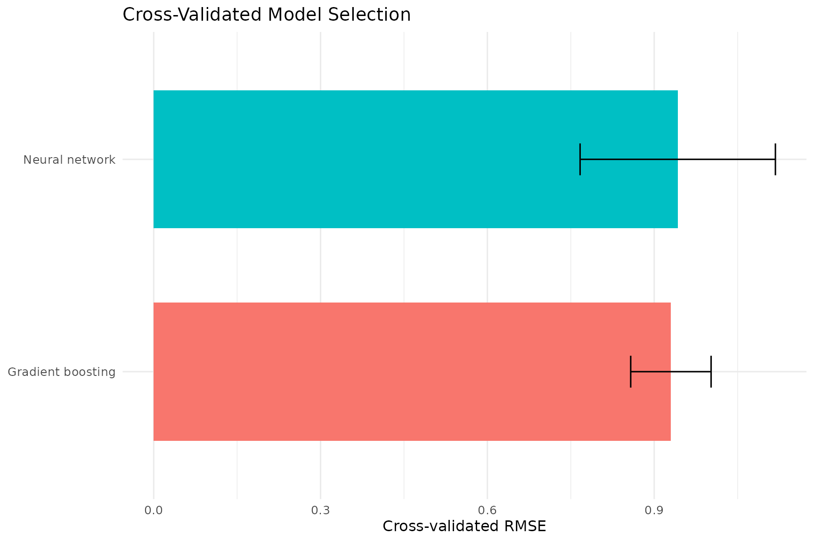

## Decision stump

``` r

set.seed(623)

n_stump <- 200
X_stump <- cbind(
  X1 = rnorm(n_stump),
  X2 = rnorm(n_stump),
  X3 = rnorm(n_stump)
)

y_stump <- ifelse(
  X_stump[, "X1"] > 0,
  3 + X_stump[, "X2"],
  -3 + X_stump[, "X2"]
) + rnorm(n_stump, sd = 0.4)

stump_model <- fit_stump(X_stump, y_stump)

predict_stump <- function(X, model) {
  feature <- model$feature + 1L
  ifelse(
    X[, feature] <= model$threshold,
    model$left_val,
    model$right_val
  )
}

stump_prediction <- predict_stump(X_stump, stump_model)
rmse(y_stump, stump_prediction)
#> [1] 3.495421
```

## Classification helpers

``` r

classification_metrics <- function(actual, predicted) {
  actual <- as.integer(actual)
  predicted <- as.integer(predicted)

  tp <- sum(actual == 1 & predicted == 1)
  tn <- sum(actual == 0 & predicted == 0)
  fp <- sum(actual == 0 & predicted == 1)
  fn <- sum(actual == 1 & predicted == 0)

  accuracy <- (tp + tn) / length(actual)
  precision <- tp / max(1, tp + fp)
  recall <- tp / max(1, tp + fn)
  specificity <- tn / max(1, tn + fp)
  f1 <- if (precision + recall == 0) {
    0
  } else {
    2 * precision * recall / (precision + recall)
  }

  data.frame(
    Accuracy = accuracy,
    Precision = precision,
    Recall = recall,
    Specificity = specificity,
    F1 = f1
  )
}

roc_curve_data <- function(actual, probability) {
  thresholds <- sort(
    unique(c(Inf, probability, -Inf)),
    decreasing = TRUE
  )

  roc_points <- lapply(thresholds, function(threshold) {
    predicted <- as.integer(probability >= threshold)
    tp <- sum(actual == 1 & predicted == 1)
    tn <- sum(actual == 0 & predicted == 0)
    fp <- sum(actual == 0 & predicted == 1)
    fn <- sum(actual == 1 & predicted == 0)

    data.frame(
      Threshold = threshold,
      TPR = tp / max(1, tp + fn),
      FPR = fp / max(1, fp + tn)
    )
  })

  result <- do.call(rbind, roc_points)
  result[order(result$FPR, result$TPR), ]
}

auc_from_roc <- function(roc_data) {
  roc_data <- roc_data[order(roc_data$FPR, roc_data$TPR), ]
  sum(
    diff(roc_data$FPR) *
      (head(roc_data$TPR, -1) + tail(roc_data$TPR, -1)) / 2
  )
}

confusion_plot_data <- function(actual, predicted) {
  as.data.frame(
    table(
      Observed = factor(actual, levels = c(0, 1)),
      Predicted = factor(predicted, levels = c(0, 1))
    )
  )
}
```

## Linear binary classification

``` r

set.seed(738)

n_linear <- 500
X_linear <- cbind(
  X1 = rnorm(n_linear),
  X2 = rnorm(n_linear)
)

linear_score <- (
  1.25 * X_linear[, "X1"] -
  0.85 * X_linear[, "X2"] +
  rnorm(n_linear, sd = 0.45)
)
y_linear <- ifelse(linear_score > 0, 1, 0)

linear_train_rows <- sample(
  seq_len(n_linear),
  floor(0.70 * n_linear)
)
linear_test_rows <- setdiff(seq_len(n_linear), linear_train_rows)

linear_data <- data.frame(
  X1 = X_linear[, "X1"],
  X2 = X_linear[, "X2"],
  Class = factor(y_linear),
  Partition = ifelse(
    seq_len(n_linear) %in% linear_train_rows,
    "Training",
    "Test"
  )
)
```

``` r

ggplot(linear_data, aes(X1, X2, colour = Class, shape = Partition)) +
  geom_point(alpha = 0.72) +
  coord_equal() +
  theme_minimal(base_size = 12) +
  labs(
    title = "Linear Binary Classification Data",
    x = "X1", y = "X2", colour = "Observed class"
  )
```

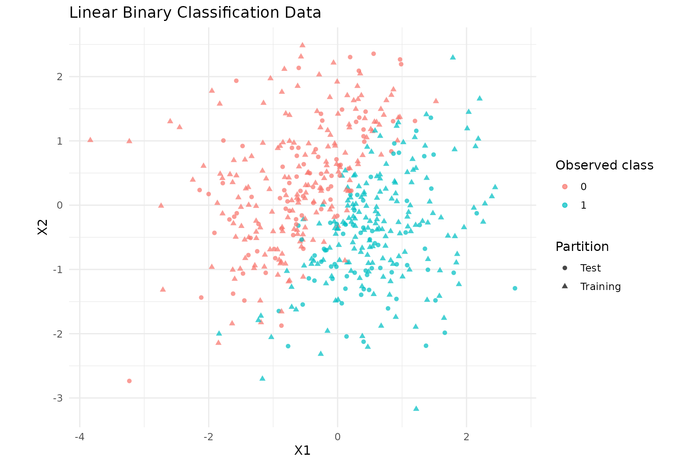

``` r

linear_forest <- rf_class_fit_fast(
  X_linear[linear_train_rows, , drop = FALSE],
  y_linear[linear_train_rows],
  n_trees = 100,
  max_depth = 6
)

linear_probability <- as.vector(
  GradBoostR::rf_class_predict_prob_fast(
    X_linear[linear_test_rows, , drop = FALSE],
    linear_forest
  )
)
linear_prediction <- as.integer(linear_probability >= 0.5)
linear_metrics <- classification_metrics(
  y_linear[linear_test_rows],
  linear_prediction
)
linear_metrics
#>    Accuracy Precision    Recall Specificity        F1
#> 1 0.9533333 0.9428571 0.9565217   0.9506173 0.9496403
```

``` r

linear_confusion <- confusion_plot_data(
  y_linear[linear_test_rows],
  linear_prediction
)

ggplot(linear_confusion, aes(Predicted, Observed, fill = Freq)) +
  geom_tile(colour = "white", linewidth = 0.8) +
  geom_text(aes(label = Freq), size = 5) +
  scale_fill_viridis_c(option = "C") +
  coord_equal() +
  theme_minimal(base_size = 12) +
  theme(panel.grid = element_blank()) +
  labs(
    title = "Linear Classification Confusion Matrix",
    x = "Predicted class", y = "Observed class", fill = "Count"
  )
```

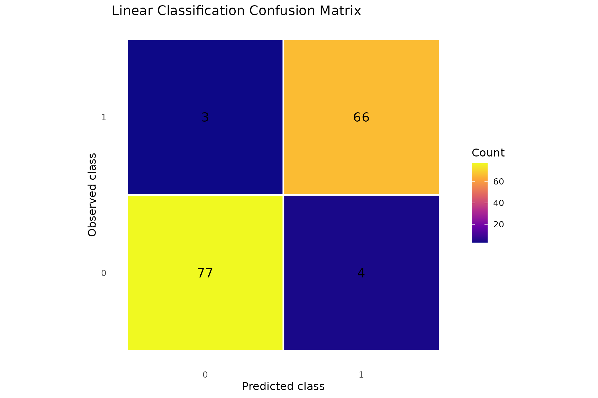

``` r

linear_roc <- roc_curve_data(
  y_linear[linear_test_rows],
  linear_probability
)
linear_auc <- auc_from_roc(linear_roc)

ggplot(linear_roc, aes(FPR, TPR)) +
  geom_line(colour = "darkgreen", linewidth = 1) +
  geom_abline(
    intercept = 0, slope = 1,
    linetype = "dashed", colour = "grey50"
  ) +
  coord_equal() +
  theme_minimal(base_size = 12) +
  labs(
    title = "Linear Classification ROC Curve",
    subtitle = paste("Held-out AUC =", round(linear_auc, 4)),
    x = "False positive rate",
    y = "True positive rate"
  )
```

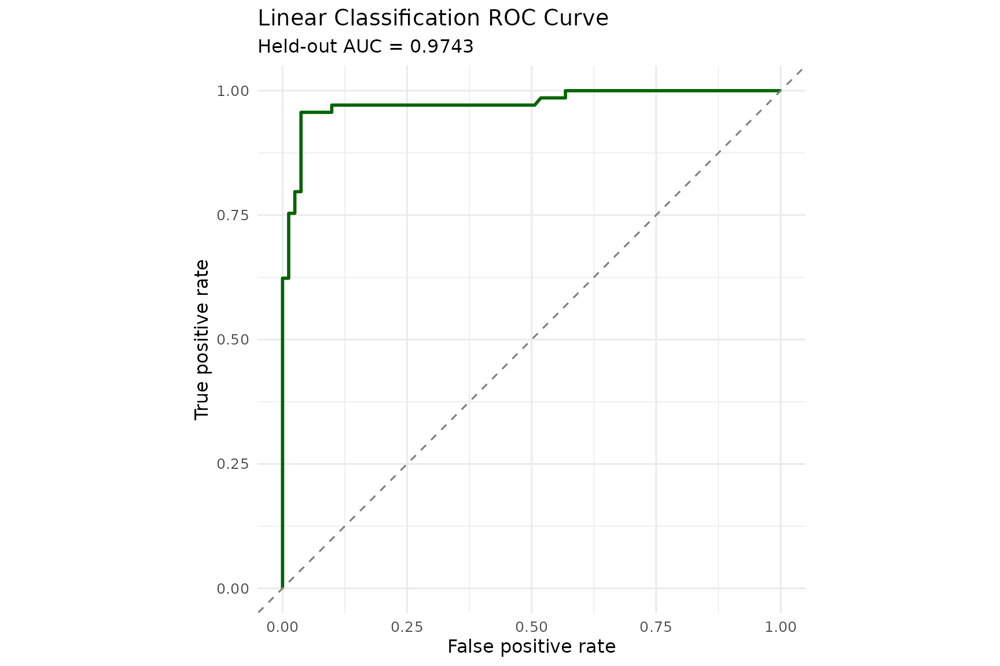

## Nonlinear binary classification

``` r

set.seed(353)

n_class <- 500
X_class <- cbind(
  X1 = rnorm(n_class),
  X2 = rnorm(n_class)
)

y_class <- ifelse(
  X_class[, "X1"]^2 + X_class[, "X2"]^2 > 1,
  1,
  0
)

nonlinear_train_rows <- sample(
  seq_len(n_class),
  floor(0.70 * n_class)
)
nonlinear_test_rows <- setdiff(seq_len(n_class), nonlinear_train_rows)

classification_data <- data.frame(
  X1 = X_class[, "X1"],
  X2 = X_class[, "X2"],
  Class = factor(
    y_class,
    levels = c(0, 1),
    labels = c("Inside", "Outside")
  ),
  Partition = ifelse(
    seq_len(n_class) %in% nonlinear_train_rows,
    "Training",
    "Test"
  )
)
```

``` r

ggplot(
  classification_data,
  aes(X1, X2, colour = Class, shape = Partition)
) +
  geom_point(alpha = 0.72) +
  scale_colour_manual(
    values = c("Inside" = "#2166AC", "Outside" = "#B2182B")
  ) +
  coord_equal() +
  theme_minimal(base_size = 12) +
  labs(
    title = "Nonlinear Binary Classification Data",
    subtitle = "The true class boundary is approximately circular",
    x = "X1", y = "X2", colour = "Observed class"
  )
```

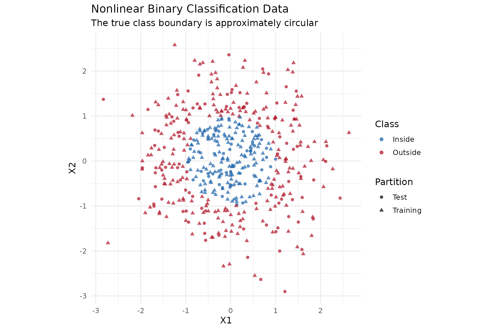

``` r

nonlinear_forest <- rf_class_fit_fast(
  X_class[nonlinear_train_rows, , drop = FALSE],
  y_class[nonlinear_train_rows],
  n_trees = 100,
  max_depth = 6
)

nonlinear_probability <- as.vector(
  GradBoostR::rf_class_predict_prob_fast(
    X_class[nonlinear_test_rows, , drop = FALSE],
    nonlinear_forest
  )
)
nonlinear_prediction <- as.integer(nonlinear_probability >= 0.5)
nonlinear_metrics <- classification_metrics(
  y_class[nonlinear_test_rows],
  nonlinear_prediction
)
nonlinear_metrics
#>    Accuracy Precision    Recall Specificity        F1
#> 1 0.9466667  0.967033 0.9462366   0.9473684 0.9565217
```

``` r

nonlinear_confusion <- confusion_plot_data(
  y_class[nonlinear_test_rows],
  nonlinear_prediction
)

ggplot(nonlinear_confusion, aes(Predicted, Observed, fill = Freq)) +
  geom_tile(colour = "white", linewidth = 0.8) +
  geom_text(aes(label = Freq), size = 5) +
  scale_fill_viridis_c(option = "C") +
  coord_equal() +
  theme_minimal(base_size = 12) +
  theme(panel.grid = element_blank()) +
  labs(
    title = "Nonlinear Classification Confusion Matrix",
    x = "Predicted class", y = "Observed class", fill = "Count"
  )
```

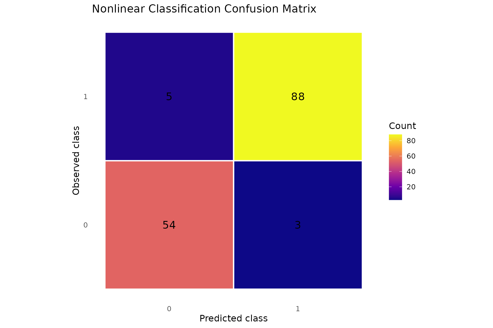

``` r

nonlinear_roc <- roc_curve_data(
  y_class[nonlinear_test_rows],
  nonlinear_probability
)
nonlinear_auc <- auc_from_roc(nonlinear_roc)

ggplot(nonlinear_roc, aes(FPR, TPR)) +
  geom_line(colour = "dodgerblue3", linewidth = 1) +
  geom_abline(
    intercept = 0, slope = 1,
    linetype = "dashed", colour = "grey50"
  ) +
  coord_equal() +
  theme_minimal(base_size = 12) +
  labs(
    title = "Nonlinear Classification ROC Curve",
    subtitle = paste("Held-out AUC =", round(nonlinear_auc, 4)),
    x = "False positive rate",
    y = "True positive rate"
  )
```

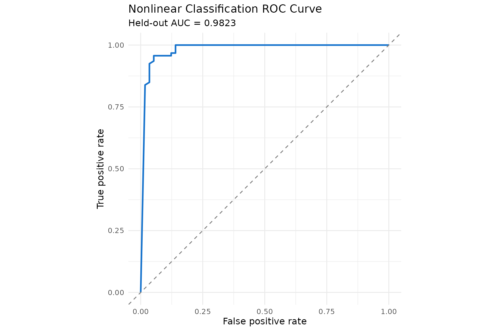

## Classification comparison

``` r

classification_comparison <- rbind(
  data.frame(
    Example = "Linear boundary",
    linear_metrics,
    AUC = linear_auc
  ),
  data.frame(
    Example = "Circular boundary",
    nonlinear_metrics,
    AUC = nonlinear_auc
  )
)

knitr::kable(
  classification_comparison,
  digits = 4,
  caption = "Held-out classification performance"
)
```

| Example           | Accuracy | Precision | Recall | Specificity |     F1 |    AUC |
|:------------------|---------:|----------:|-------:|------------:|-------:|-------:|
| Linear boundary   |   0.9533 |    0.9429 | 0.9565 |      0.9506 | 0.9496 | 0.9743 |
| Circular boundary |   0.9467 |    0.9670 | 0.9462 |      0.9474 | 0.9565 | 0.9823 |

Held-out classification performance {.table style="width:100%;"}

``` r

classification_comparison_long <- rbind(
  data.frame(
    Example = classification_comparison$Example,
    Metric = "Accuracy",
    Value = classification_comparison$Accuracy
  ),
  data.frame(
    Example = classification_comparison$Example,
    Metric = "F1",
    Value = classification_comparison$F1
  ),
  data.frame(
    Example = classification_comparison$Example,
    Metric = "AUC",
    Value = classification_comparison$AUC
  )
)

ggplot(
  classification_comparison_long,
  aes(Metric, Value, fill = Example)
) +
  geom_col(position = "dodge", width = 0.68) +
  scale_y_continuous(
    limits = c(0, 1.05),
    breaks = seq(0, 1, by = 0.2)
  ) +
  theme_minimal(base_size = 12) +
  labs(
    title = "Classification Example Comparison",
    subtitle = "Metrics are calculated on held-out test observations",
    x = NULL, y = "Value", fill = "Example"
  )
```

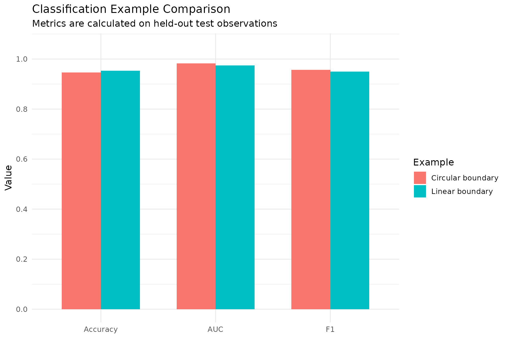

## Nonlinear probability surface and decision boundary

The surface model is fitted on the complete nonlinear data set for
visualization. Held-out metrics above remain the appropriate performance
estimates.

``` r

classification_surface_forest <- rf_class_fit_fast(
  X_class,
  y_class,
  n_trees = 100,
  max_depth = 6
)

classification_grid <- expand.grid(
  X1 = seq(
    min(classification_data$X1),
    max(classification_data$X1),
    length.out = 150
  ),
  X2 = seq(
    min(classification_data$X2),
    max(classification_data$X2),
    length.out = 150
  )
)

classification_grid$Probability <- as.vector(
  GradBoostR::rf_class_predict_prob_fast(
    as.matrix(classification_grid[, c("X1", "X2")]),
    classification_surface_forest
  )
)

stopifnot(
  length(classification_grid$Probability) == nrow(classification_grid)
)
```

``` r

ggplot() +
  geom_raster(
    data = classification_grid,
    aes(X1, X2, fill = Probability),
    interpolate = FALSE
  ) +
  geom_contour(
    data = classification_grid,
    aes(X1, X2, z = Probability),
    breaks = c(0.1, 0.3, 0.5, 0.7, 0.9),
    colour = "white",
    linewidth = 0.45
  ) +
  geom_contour(
    data = classification_grid,
    aes(X1, X2, z = Probability),
    breaks = 0.5,
    colour = "black",
    linewidth = 0.9
  ) +
  geom_point(
    data = classification_data,
    aes(X1, X2, colour = Class),
    alpha = 0.65,
    size = 1.3
  ) +
  scale_fill_viridis_c(
    limits = c(0, 1),
    name = "P(Class = 1)"
  ) +
  scale_colour_manual(
    values = c("Inside" = "#2166AC", "Outside" = "#B2182B")
  ) +
  coord_equal() +
  theme_minimal(base_size = 12) +
  labs(
    title = "GradBoostR Classification Probability Surface",
    subtitle = "The black contour is the P(Class = 1) = 0.5 decision boundary",
    x = "X1", y = "X2", colour = "Observed class"
  )
```

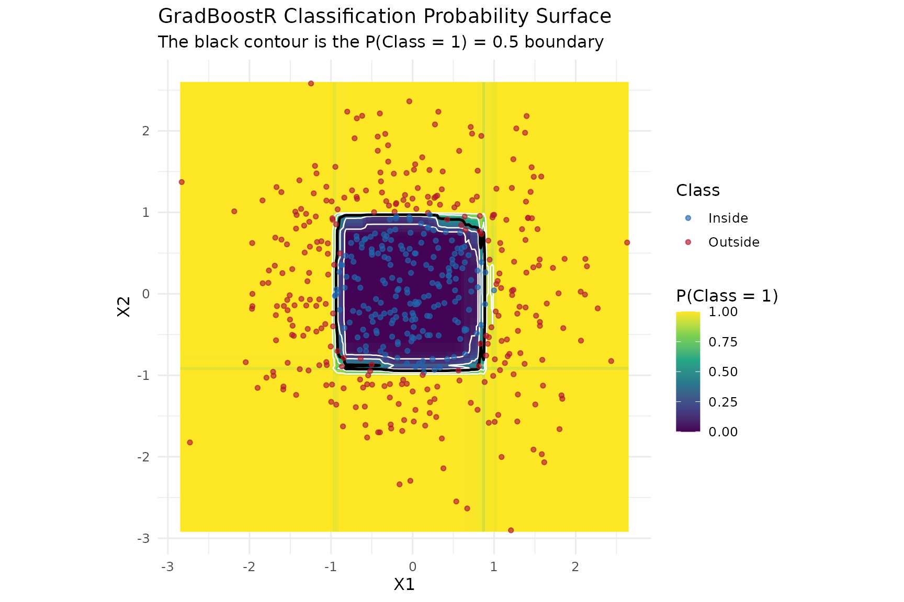

## Summary

This vignette demonstrated:

- random forest, gradient boosting, and neural network regression;
- fold-specific predictor scaling and three-fold cross-validation;
- learning-rate analysis for gradient boosting and neural networks;
- grid search and cross-validated model selection;
- decision stump fitting;
- linear and nonlinear binary classification;
- held-out accuracy, precision, recall, specificity, and F1-score;
- confusion-matrix heatmaps;
- ROC curves and AUC;
- class-probability prediction;
- nonlinear probability surfaces and decision boundaries.

The unified
[`gradboostr_fit()`](https://nicjc.github.io/GradBoostR/reference/gradboostr_fit.md)
and
[`gradboostr_predict()`](https://nicjc.github.io/GradBoostR/reference/gradboostr_predict.md)
interface provides a consistent workflow across the regression models.
Lower-level functions provide specialised decision-stump and fast
random-forest classification functionality.
