# Introduction to GradBoostR

### Example Dataset

``` r

X <- matrix(rnorm(300), ncol = 3)
y_reg <- X[,1] * 2 + rnorm(100)
y_class <- factor(ifelse(X[,1] + X[,2] > 0, "A", "B"))

df <- data.frame(
  X1 = X[,1],
  X2 = X[,2],
  X3 = X[,3],
  y_reg = y_reg,
  y_class = y_class
)
```

``` r

head(df,8)
```

               X1          X2         X3      y_reg y_class
    1 -0.56047565 -0.71040656  2.1988103 -1.8361935       B
    2 -0.23017749  0.25688371  1.3124130 -1.2130439       A
    3  1.55870831 -0.24669188 -0.2651451  2.1788779       A
    4  0.07050839 -0.34754260  0.5431941 -0.9114965       B
    5  0.12928774 -0.95161857 -0.4143399 -0.1785841       B
    6  1.71506499 -0.04502772 -0.4762469  3.7613091       A
    7  0.46091621 -0.78490447 -0.7886028 -1.0923781       B
    8 -1.26506123 -1.66794194 -0.5946173 -2.3181420       B

## Visualizing the dataset

``` r

df %>% ggplot() +
  aes(X1, y_reg) +
  geom_point(alpha = 0.6, color = "steelblue") +
  labs(
    title = "Example Dataset: X1 vs y_reg",
    x = "X1",
    y = "Regression Target"
  )
```

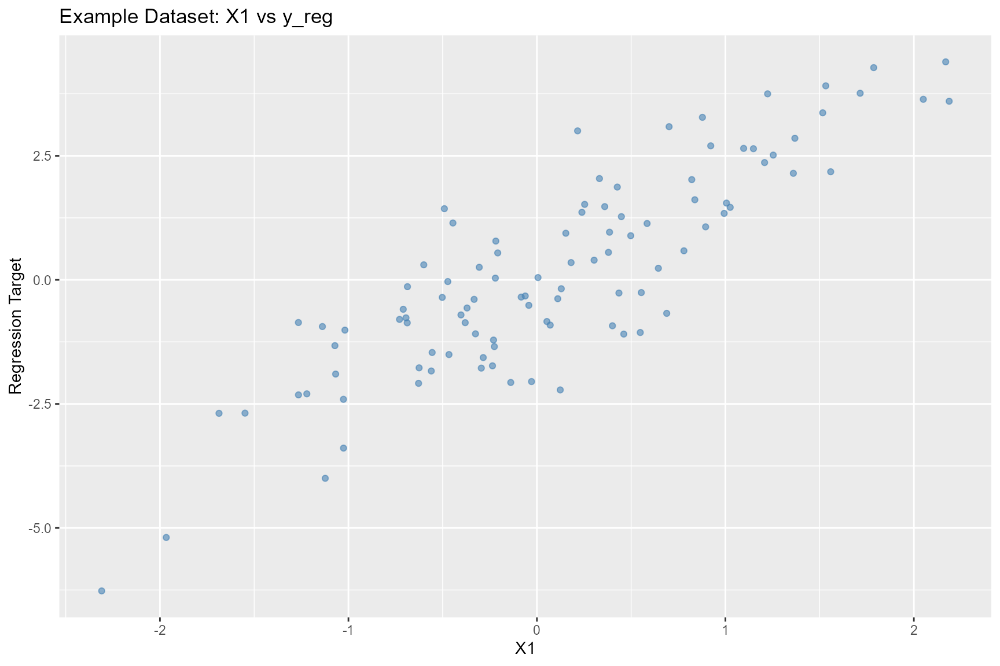

## Random Forest Regression

``` r

m_rf <- gradboostr_fit(X, y_reg, method = "rf")
pred_rf <- gradboostr_predict(m_rf, X)
head(pred_rf,8)
```

               [,1]
    [1,] -1.0868246
    [2,] -0.8198657
    [3,]  2.8271385
    [4,] -0.5446718
    [5,] -0.4873960
    [6,]  3.6988614
    [7,] -0.1153470
    [8,] -1.9551827

## Prediction vs Truth

``` r

df_rf <- data.frame(True = y_reg, Pred = pred_rf)

df_rf %>% ggplot() +
  aes(True, Pred) +
  geom_point(alpha = 0.6, color = "darkgreen") +
  geom_abline(color = "red", linetype = "dashed") +
  theme_minimal() +
  labs(
    title = "Random Forest Regression: Prediction vs Truth",
    x = "True Values",
    y = "Predicted Values"
  )
```

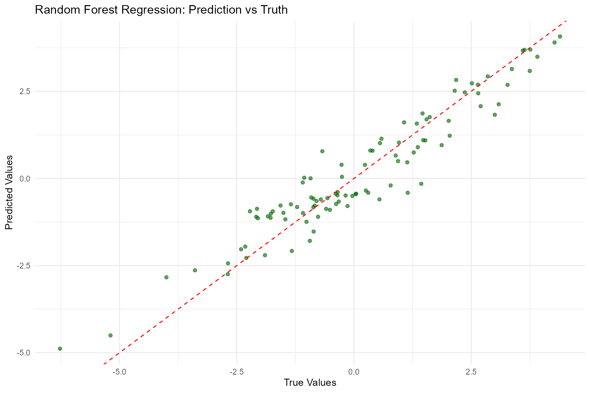

## Random Forest Classification

``` r

m_rf_c <- gradboostr_fit(X, y_class, method = "rf_class")
```

    ENTER rf_class_fit_fast n_trees=100 max_depth=5 mtry=3
    BEFORE build loop n_trees=100 nrows=100 ncols=3

``` r

pred_class <- gradboostr_predict(m_rf_c, X, type = "response")
head(pred_class,8)
```

    [1] B A A A B A A B
    Levels: A B

## Classification Boundary

``` r

df_class <- data.frame(
  X1 = X[,1],
  X2 = X[,2],
  Class = pred_class
)

df_class %>% ggplot() +
  aes(X1, X2, color = Class) +
  geom_point(alpha = 0.6) +
  theme_grey() +
  labs(
    title = "Random Forest Classification Boundary",
    x = "X1",
    y = "X2",
    color = "Predicted Class" 
    )
```

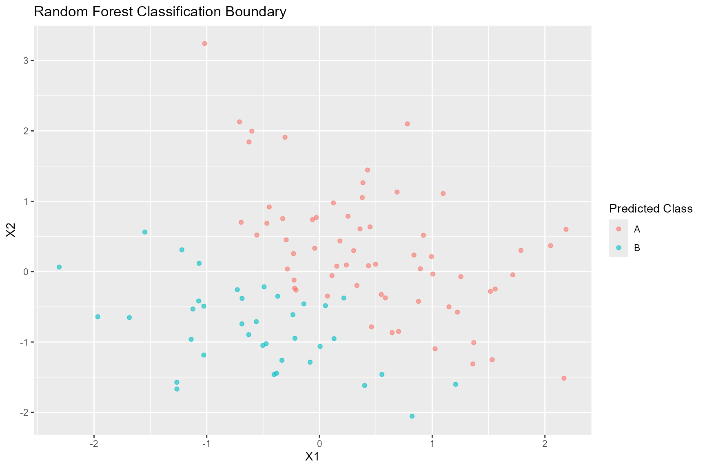

``` r

df_class %>% ggplot() +
  aes(Class) +
  geom_bar(fill = "darkcyan" , alpha = 0.7) +
  theme_classic() +
  labs(
    title = "Random Forest Classification: Class Distribution",
    x = "Class",
    y = "Count"
  )
```

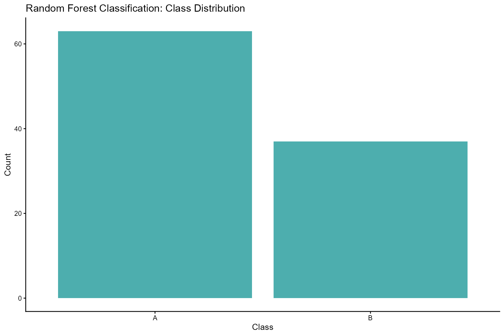

### Gradient Boosting Regression

``` r

m_gbm <- gradboostr_fit(X, y_reg, method = "gbm", learning_rate = 0.1, n_trees = 50)
pred_gbm <- gradboostr_predict(m_gbm, X)
head(pred_gbm,8)
```

    [1] -0.9565474 -0.6889054  2.9151818 -0.5991154 -0.1760658  3.3179254  0.6155382
    [8] -1.8862787

## Prediction vs Truth

``` r

df_gbm <- data.frame(True = y_reg, Pred = pred_gbm)

ggplot(df_gbm, aes(True, Pred)) +
  geom_point(alpha = 0.6, color = "darkorange") +
  geom_abline(color = "black", linetype = "dotted") +
  theme_light() +
  labs(
    title = "GBM Regression: Prediction vs Truth",
    x = "True Values",
    y = "Predicted Values"
  )
```

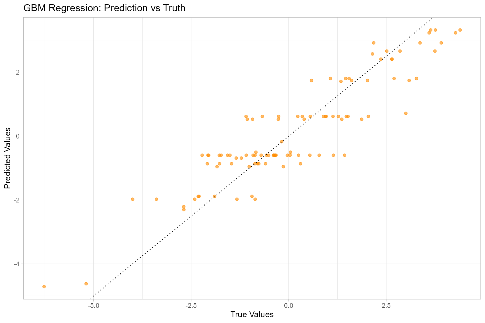

## Neural Network Regression

``` r

m_nn <- gradboostr_fit(X, y_reg, method = "nn", hidden = 10, epochs = 50)
pred_nn <- gradboostr_predict(m_nn, X)
head(pred_nn,8)
```

               [,1]
    [1,] 0.08696725
    [2,] 0.08952569
    [3,] 0.09348689
    [4,] 0.09084726
    [5,] 0.09180588
    [6,] 0.09358113
    [7,] 0.09291799
    [8,] 0.08680833

## Prediction vs Truth

``` r

df_nn <- data.frame(True = y_reg, Pred = pred_nn)

df_nn %>%
  ggplot() + aes(True, Pred) +
  geom_point(alpha = 0.6) +
  geom_jitter(color = "dodgerblue") + 
  geom_abline(color = "red", linetype = "dashed") +
   theme_grey() +
   labs(
    title = "Neural Network Regression: Prediction vs Truth",
    x = "True Values",
    y = "Predicted Values"
  )
```

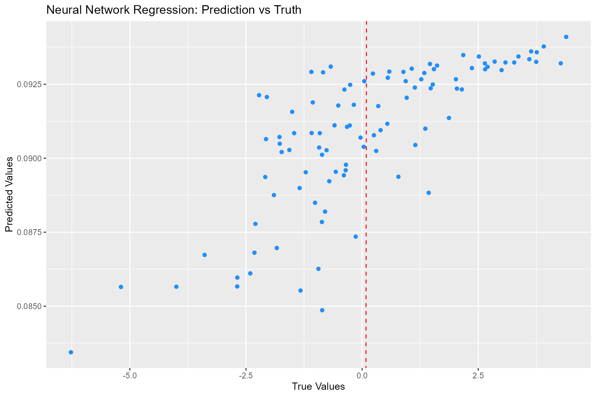

## NN vs RF vs GBM Comparison

``` r

df_all <- data.frame(
  True = y_reg,
  RF = pred_rf,
  GBM = pred_gbm,
  NN = pred_nn
)

library(tidyr)

df_long <- pivot_longer(df_all, cols = c("RF", "GBM", "NN"),
                        names_to = "Model", values_to = "Pred")

df_long %>% ggplot() +
  aes(True, Pred, color = Model) +
  geom_point(alpha = 0.5) +
  geom_abline(color = "black", linetype = "dashed") +
  theme_gray() +
  labs(
    title = "Model Comparison: Prediction vs Truth",
    x = "True Values",
    y = "Predicted Values"
  )
```

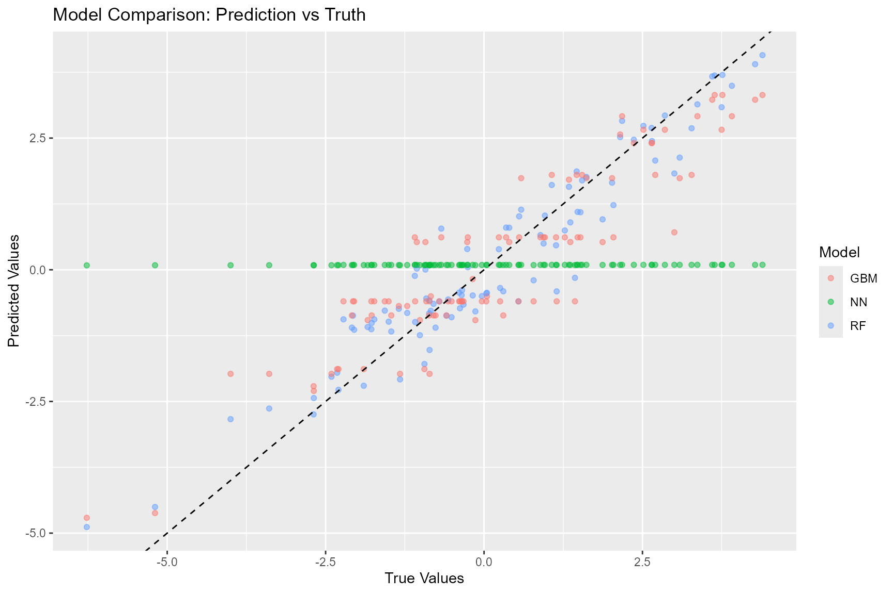

## NN Residual Plot

``` r

df_res <- data.frame(
  Pred = pred_nn,
  Resid = y_reg - pred_nn
)

ggplot(df_res, aes(Pred, Resid)) +
  geom_point(alpha = 0.6, color = "purple") +
  theme_minimal() +
  labs(
    title = "NN Residuals (hidden = 10)",
    x = "Predicted",
    y = "Residual"
  )
```

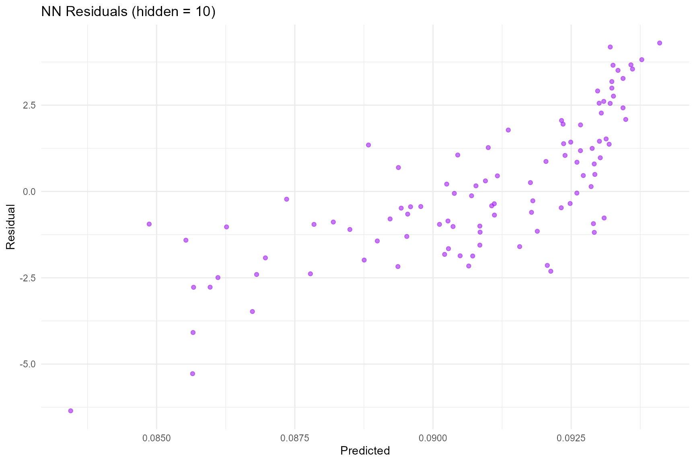

## Tuning Hidden Layer Size

``` r

sizes <- c(5, 10, 20, 40)

results <- lapply(sizes, function(h) {
  m <- gradboostr_fit(X, y_reg, method = "nn", hidden = h, epochs = 50)
  pred <- gradboostr_predict(m, X)
  rmse <- sqrt(mean((pred - y_reg)^2))
  data.frame(hidden = h, RMSE = rmse)
})

do.call(rbind, results)
```

      hidden     RMSE
    1      5 2.049373
    2     10 2.048961
    3     20 2.046544
    4     40 2.045128

## Visualizing Hidden Layer Tuning

``` r

df_tune <- do.call(rbind, results)

ggplot(df_tune, aes(hidden, RMSE)) +
  geom_line(color = "darkgreen") +
  geom_point(size = 3) +
  theme_minimal() +
  labs(
    title = "Effect of Hidden Layer Size on NN Performance",
    x = "Hidden Units",
    y = "RMSE"
  )
```

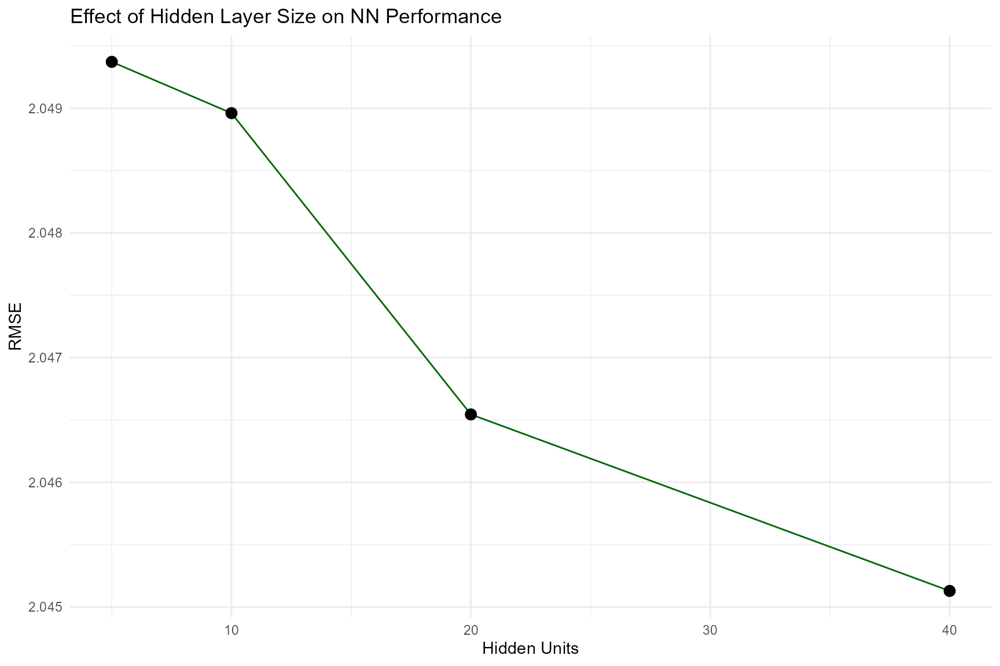

## Training Time Benchmark

``` r

bench_gbm <- system.time({
  gbm_model <- gradboostr_fit(X, y_reg, method = "gbm",
                              learning_rate = 0.1, n_trees = 50)
})

bench_rf <- system.time({
  rf_model <- gradboostr_fit(X, y_reg, method = "rf")
})

bench_nn <- system.time({
  nn_model <- gradboostr_fit(X, y_reg, method = "nn",
                             hidden = 10, epochs = 50)
})

bench_gbm
```

       user  system elapsed 
       0.02    0.00    0.00 

``` r

bench_rf
```

       user  system elapsed 
       0.06    0.00    0.06 

``` r

bench_nn
```

       user  system elapsed 
          0       0       0 

## Benchmark plot

``` r

df_bench <- data.frame(
  Model = c("GBM", "RF", "NN"),
  Time  = c(
    bench_gbm["elapsed"],
    bench_rf["elapsed"],
    bench_nn["elapsed"]
  )
)

ggplot(df_bench, aes(Model, Time)) +
  geom_col(fill = "steelblue") +
  theme_minimal() +
  labs(
    title = "Training Time Comparison",
    y = "Elapsed Time (seconds)"
  )
```

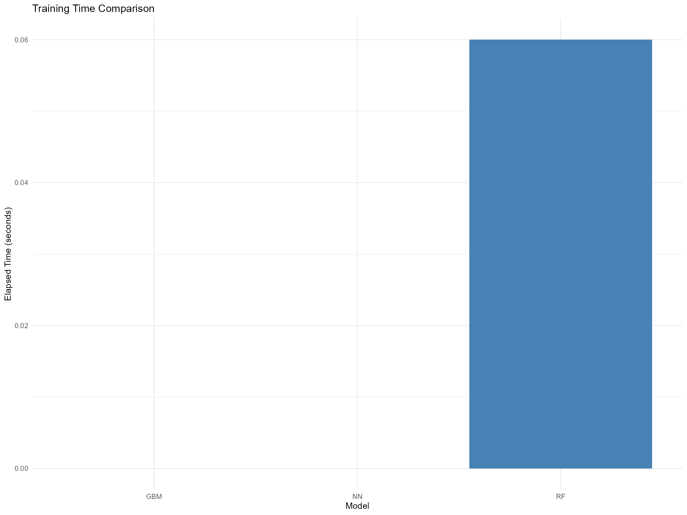

## NN Example with Scaled Inputs

``` r

X_scaled <- scale(X)

m_nn_scaled <- gradboostr_fit(X_scaled, y_reg, method = "nn", hidden = 10, epochs = 50)
pred_nn_scaled <- gradboostr_predict(m_nn_scaled, X_scaled)

head(pred_nn_scaled,8)
```

               [,1]
    [1,] 0.08608016
    [2,] 0.08885056
    [3,] 0.09663287
    [4,] 0.09058510
    [5,] 0.09174764
    [6,] 0.09712062
    [7,] 0.09429983
    [8,] 0.08458144

## Learning Rate Example

``` r

# Example data
X <- matrix(rnorm(300), ncol = 3)
y_reg <- X[,1] * 2 + rnorm(100)

# Fit models with different learning rates
m_lr_01 <- gradboostr_fit(X, y_reg, method = "gbm",
                          learning_rate = 0.1, n_trees = 50)

m_lr_005 <- gradboostr_fit(X, y_reg, method = "gbm",
                           learning_rate = 0.05, n_trees = 50)

m_lr_001 <- gradboostr_fit(X, y_reg, method = "gbm",
                           learning_rate = 0.01, n_trees = 50)

# Predictions
pred_01  <- gradboostr_predict(m_lr_01,  X)
pred_005 <- gradboostr_predict(m_lr_005, X)
pred_001 <- gradboostr_predict(m_lr_001, X)

# RMSE helper
rmse <- function(a, b) sqrt(mean((a - b)^2))

# Results table
df_lr <- data.frame(
  learning_rate = c(0.1, 0.05, 0.01),
  RMSE = c(
    rmse(pred_01,  y_reg),
    rmse(pred_005, y_reg),
    rmse(pred_001, y_reg)
  )
)

df_lr
```

      learning_rate      RMSE
    1          0.10 0.9181006
    2          0.05 1.1167179
    3          0.01 1.7211093

``` r

df_lr %>% ggplot() +
  aes(learning_rate, RMSE) +
  geom_point(size = 3, color = "darkcyan") +
  geom_line(color = "violet") +
  theme_minimal() +
  labs(
    title = "Effect of Learning Rate on GBM Performance",
    x = "Learning Rate",
    y = "RMSE"
  )
```

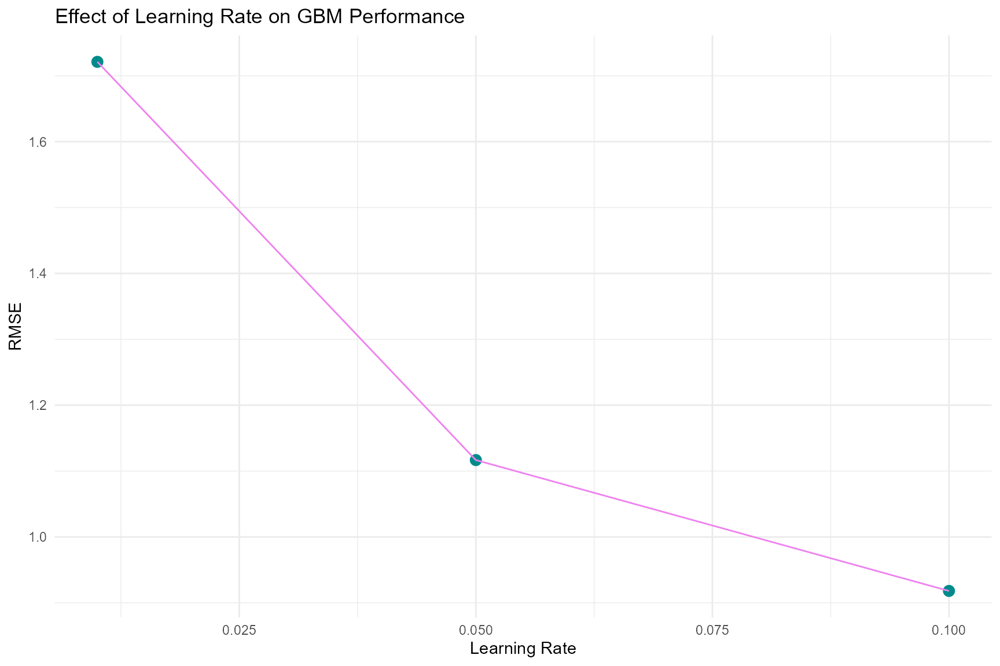

## Neural Network Learning Rate

``` r

# Example dataset
set.seed(1)
X <- matrix(rnorm(300), ncol = 3)
y_reg <- X[,1] * 2 + rnorm(100)

# Scale inputs (NNs perform better with scaled features)
X_scaled <- scale(X)

# Fit NN models with different learning rates
m_lr_01  <- gradboostr_fit(X_scaled, y_reg, method = "nn",
                           hidden = 10, epochs = 80, learning_rate = 0.1)

m_lr_005 <- gradboostr_fit(X_scaled, y_reg, method = "nn",
                           hidden = 10, epochs = 80, learning_rate = 0.05)

m_lr_001 <- gradboostr_fit(X_scaled, y_reg, method = "nn",
                           hidden = 10, epochs = 80, learning_rate = 0.01)
# Predictions
pred_01  <- gradboostr_predict(m_lr_01,  X_scaled)
pred_005 <- gradboostr_predict(m_lr_005, X_scaled)
pred_001 <- gradboostr_predict(m_lr_001, X_scaled)

# RMSE helper
rmse <- function(a, b) sqrt(mean((a - b)^2))

# Results table
df_lr <- data.frame(
  learning_rate = c(0.1, 0.05, 0.01),
  RMSE = c(
    rmse(pred_01,  y_reg),
    rmse(pred_005, y_reg),
    rmse(pred_001, y_reg)
  )
)

df_lr
```

      learning_rate      RMSE
    1          0.10 0.9087489
    2          0.05 0.9464590
    3          0.01 1.9934758

``` r

df_lr %>% ggplot() +
  aes(learning_rate, RMSE) +
  geom_point(size = 3, color = "darkorange") +
  geom_line(color = "steelblue") +
  theme_minimal() +
  labs(
    title = "Effect of Learning Rate on Neural Network Performance",
    x = "Learning Rate",
    y = "RMSE"
  )
```

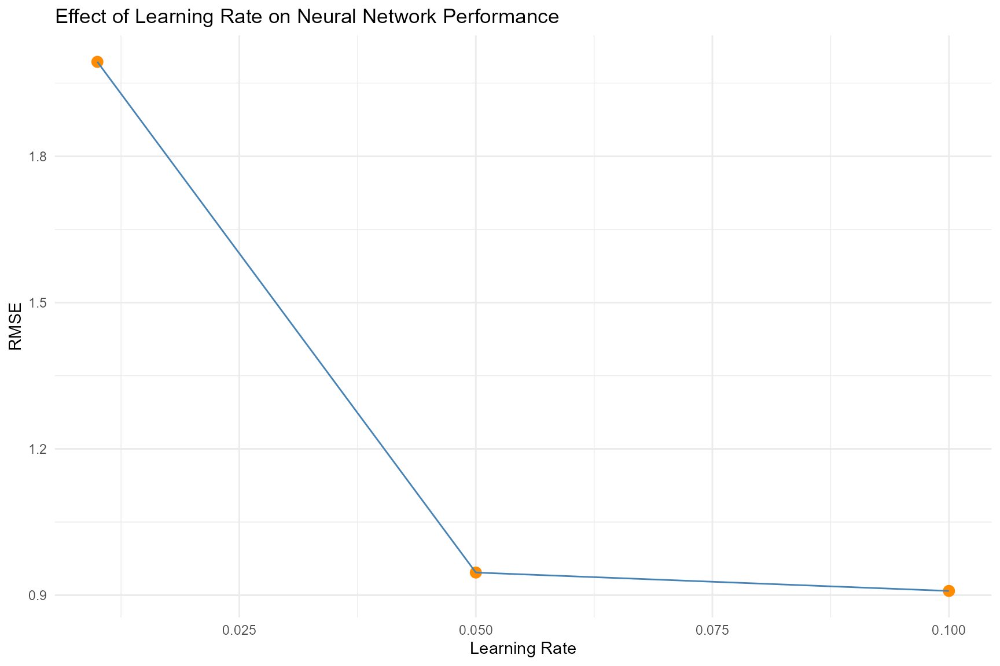

## Effect of Epochs

``` r

epochs_grid <- c(40, 80, 160)

res_epochs <- lapply(epochs_grid, function(e) {
  m <- gradboostr_fit(
    X_scaled, y_reg,
    method        = "nn",
    hidden        = 10,
    epochs        = e,
    learning_rate = 0.05
  )
  p <- gradboostr_predict(m, X_scaled)
  data.frame(epochs = e, RMSE = rmse(p, y_reg))
})

df_epochs <- do.call(rbind, res_epochs)
df_epochs
```

      epochs      RMSE
    1     40 1.8020304
    2     80 0.9469013
    3    160 0.9065189

``` r

df_epochs %>% ggplot() +
  aes(epochs, RMSE) +
  geom_point(size = 3, color = "darkorange") +
  geom_line(color = "steelblue") +
  theme_minimal() +
  labs(
    title = "Effect of Epochs on NN Performance",
    x = "Epochs",
    y = "RMSE"
  )
```

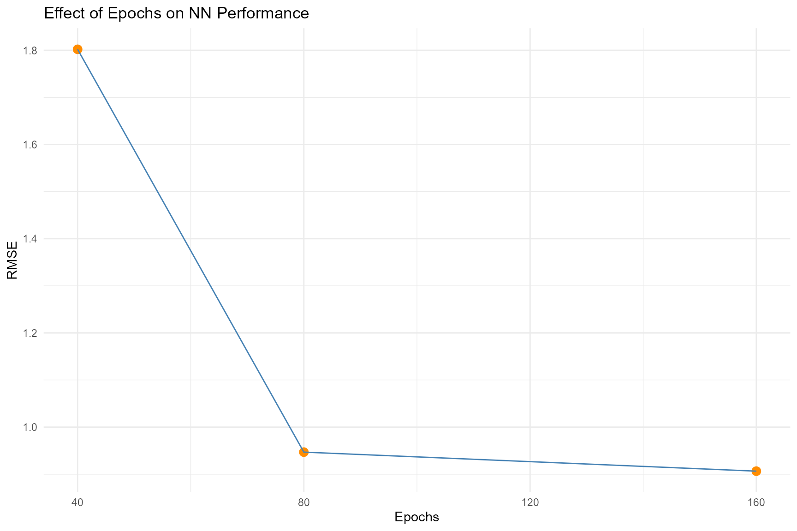

## Grid search

``` r

hidden_grid <- c(5, 10, 20)
epochs_grid <- c(40, 80)
lr_grid     <- c(0.1, 0.05, 0.01)

grid <- expand.grid(
  hidden        = hidden_grid,
  epochs        = epochs_grid,
  learning_rate = lr_grid
)

res_grid <- lapply(seq_len(nrow(grid)), function(i) {
  h  <- grid$hidden[i]
  e  <- grid$epochs[i]
  lr <- grid$learning_rate[i]

  m <- gradboostr_fit(
    X_scaled, y_reg,
    method        = "nn",
    hidden        = h,
    epochs        = e,
    learning_rate = lr
  )
  p <- gradboostr_predict(m, X_scaled)

  data.frame(
    hidden        = h,
    epochs        = e,
    learning_rate = lr,
    RMSE          = rmse(p, y_reg)
  )
})

df_grid <- do.call(rbind, res_grid)
df_grid
```

       hidden epochs learning_rate      RMSE
    1       5     40          0.10 0.9497391
    2      10     40          0.10 1.0949751
    3      20     40          0.10 0.9426432
    4       5     80          0.10 0.9091102
    5      10     80          0.10 0.9089933
    6      20     80          0.10 0.9073786
    7       5     40          0.05 1.9975288
    8      10     40          0.05 1.8030661
    9      20     40          0.05 1.3472226
    10      5     80          0.05 0.9711798
    11     10     80          0.05 0.9517309
    12     20     80          0.05 0.9492795
    13      5     40          0.01 2.0010441
    14     10     40          0.01 1.9995503
    15     20     40          0.01 2.0003769
    16      5     80          0.01 1.9943262
    17     10     80          0.01 1.9881691
    18     20     80          0.01 1.9902488

``` r

df_grid[which.min(df_grid$RMSE), ]
```

      hidden epochs learning_rate      RMSE
    6     20     80           0.1 0.9073786

``` r

df_grid %>% ggplot() +
  aes(hidden, epochs, fill = RMSE) +
  geom_tile(color = "grey70") +
  facet_wrap(~ learning_rate) +
  scale_fill_viridis_c() +
  theme_minimal() +
  labs(
    title = "NN Grid Search: Hidden, Epochs, Learning Rate",
    x = "Hidden Units",
    y = "Epochs",
    fill = "RMSE"
  )
```

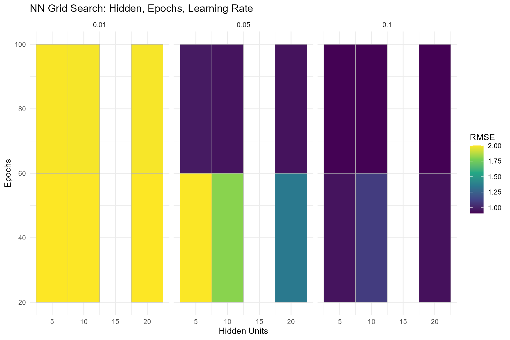 \# Fit Stump

#### Create a synthetic regression dataset with 3 features designed to highlight differences between simple and complex models.

``` r

set.seed(683)

X <- cbind(
  x1 = rnorm(300),
  x2 = rnorm(300),
  x3 = rnorm(300) 
)

y <- ifelse(X[,1] > 0, 3 + X[,2], -3 + X[,2]) + rnorm(300, sd = 0.4)

df <- data.frame(X1 = X[,1], X2 = X[,2], X3 = X[,3], y = y)
```

``` r

head(df,8)
```

              X1         X2          X3         y
    1  0.5586183 -0.4886488  0.89097596  2.702116
    2 -0.8707739  1.8971701  1.02908180 -1.566701
    3 -0.7865119 -1.5629687  0.55436748 -3.766229
    4 -1.9809988 -0.6159859 -1.89660647 -3.381007
    5 -0.2127845  2.2821943 -0.05569736  0.128354
    6  2.3647141 -0.1832020  0.94414711  2.664532
    7  0.6239657 -0.2309288 -0.36693268  2.598198
    8  1.3161158  0.7762313 -0.01019879  3.861348

## Fit stump (decision stump)

##### A decision stump is the simplest possible regression tree: it makes one split on one feature, producing two constant predictions.

##### fit_stump() implements this by exhaustively scanning:

##### every feature in the input matrix X, and

##### every possible threshold between sorted feature values,

##### and for each candidate split it computes the squared‑error loss of predicting:

##### the mean of the left partition for all points left of the threshold, and

##### the mean of the right partition for all points right of the threshold.

##### The function returns the split (feature + threshold) that yields the lowest total squared error, along with the two predicted values for the left and right regions.

``` r

stump <- fit_stump(X, y)
stump
```

    $feature
    [1] 1

    $threshold
    [1] -0.05914257

    $left_value
    [1] -2.986343

    $right_value
    [1] 2.693698

``` r

stump_predict <- function(X, stump) {
  f  <- stump$feature + 1  
  thr <- stump$threshold
  lv  <- stump$left_val
  rv  <- stump$right_val
  
  ifelse(X[, f] <= thr, lv, rv)
}
```

``` r

stump <- fit_stump(X, y)
pred_stump <- stump_predict(X, stump)

head(pred_stump, 20)
```

     [1] -2.986343  2.693698 -2.986343 -2.986343  2.693698 -2.986343 -2.986343
     [8]  2.693698  2.693698  2.693698 -2.986343 -2.986343  2.693698 -2.986343
    [15] -2.986343  2.693698 -2.986343  2.693698 -2.986343  2.693698

#### Generating predictions for other models

``` r

m_rf <- gradboostr_fit(X, y, method = "rf")
pred_rf <- gradboostr_predict(m_rf, X)
```

``` r

m_gbm <- gradboostr_fit(
  X, y,
  method        = "gbm",
  learning_rate = 0.1,
  n_trees       = 50
)
pred_gbm <- gradboostr_predict(m_gbm, X)
```

## RMSE

#### RMSE is computed for each model to determine accuracy.

``` r

rmse <- function(a, b) sqrt(mean((a - b)^2))

data.frame(
  Model = c("Stump", "Random Forest", "GBM"),
  RMSE  = c(
    rmse(pred_stump, y),
    rmse(pred_rf,    y),
    rmse(pred_gbm,   y)
  )
)
```

              Model      RMSE
    1         Stump 3.6779037
    2 Random Forest 0.3356187
    3           GBM 0.5183173

### Comparison visual

``` r

df_compare <- data.frame(
  Truth = y,
  Stump = pred_stump,
  RF    = pred_rf,
  GBM   = pred_gbm
)

df_long <- pivot_longer(
  df_compare,
  cols = c("Stump", "RF", "GBM"),
  names_to = "Model",
  values_to = "Pred"
)

ggplot(df_long, aes(Truth, Pred)) +
  geom_point(alpha = 0.6, color = "steelblue") +
  geom_abline(color = "red", linetype = "dashed", linewidth = 1) +
  facet_wrap(~ Model) +
  theme_minimal() +
  labs(
    title = "Prediction vs Truth for Stump, Random Forest, and GBM",
    subtitle = "Perfect predictions lie on the dashed diagonal line",
    x = "True Values",
    y = "Predicted Values"
  )
```

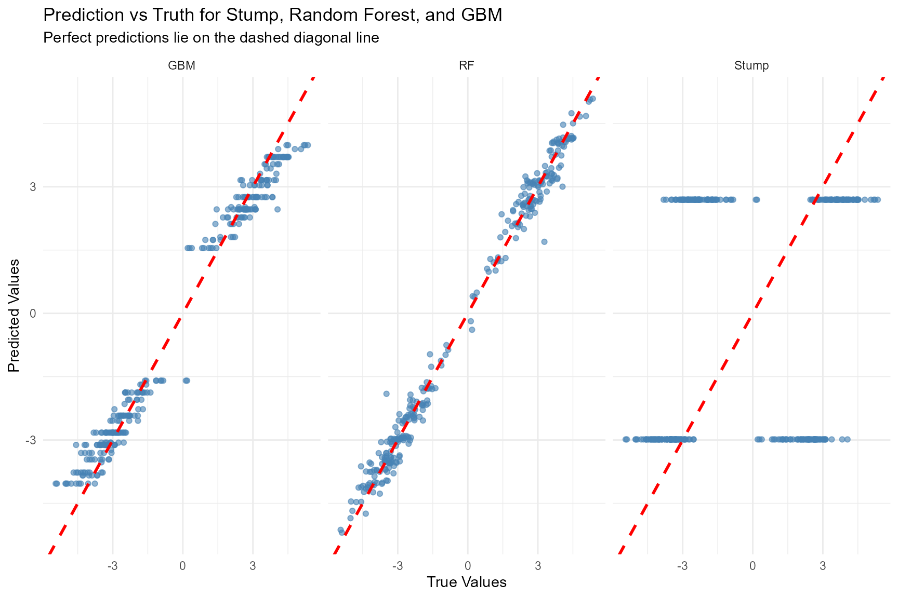

### Visuals for synthetic regression dataset.

``` r

ggplot(df, aes(X1, y, color = X2)) +
  geom_point(alpha = 0.7) +
  scale_color_gradient2(low = "blue", high = "red", mid = "white") +
  theme_minimal() +
  labs(
    title = "Synthetic Regression Data",
    subtitle = "Two regions defined by the sign of X1",
    x = "X1",
    y = "Target y",
    color = "X2"
  )
```

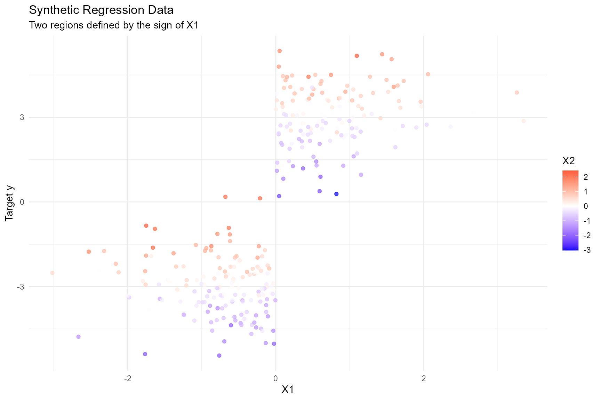

``` r

ggplot(df, aes(X1, X2, color = y)) +
  geom_point(alpha = 0.8) +
  scale_color_gradient2(low = "blue", high = "red", mid = "white") +
  theme_minimal() +
  labs(
    title = "Nonlinear Structure of the Synthetic Dataset",
    subtitle = "Clear boundary at X1 = 0",
    x = "X1",
    y = "X2",
    color = "y"
  )
```

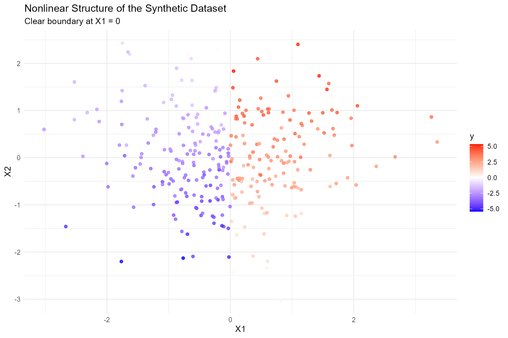
